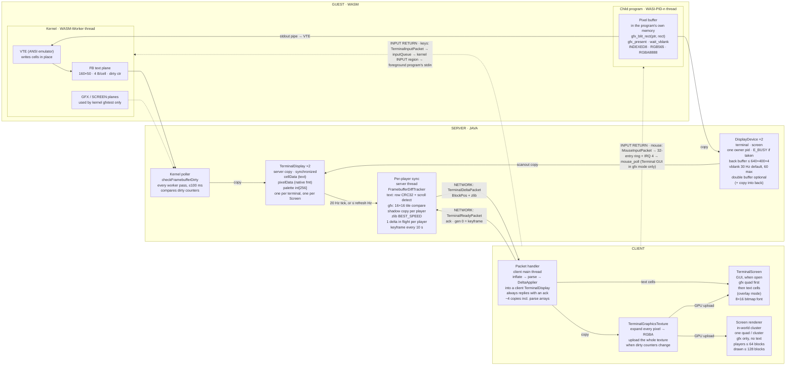
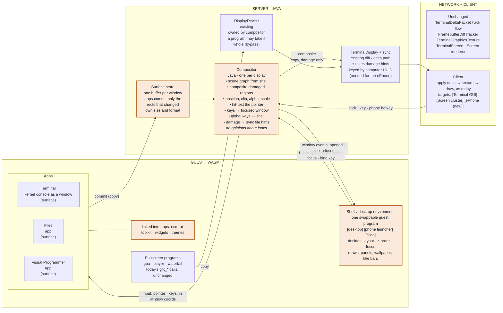
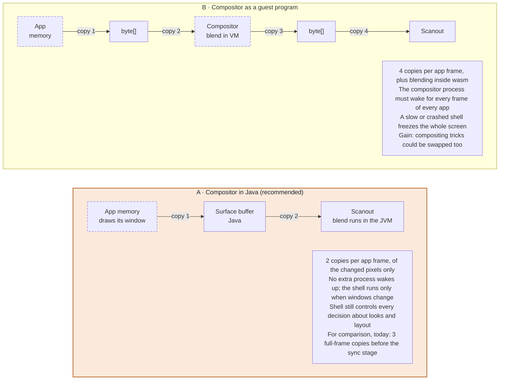
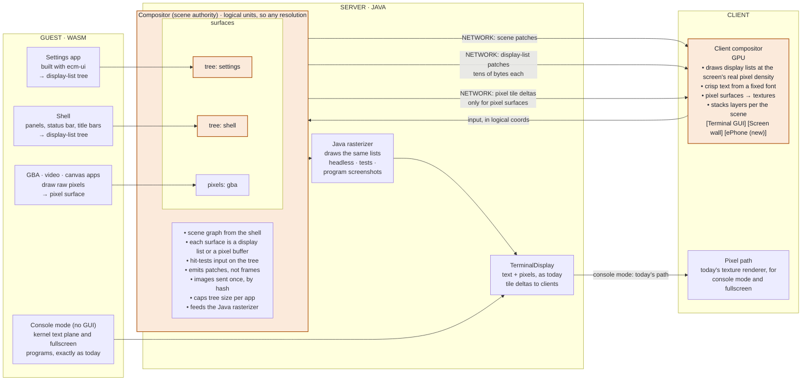

# Display Pipeline — EvansComputerMod

feature/gui-engine @ 2282c06 · 1.21.1

## Overview

How pixels get from a program running on a computer to the player's screen right now, where they get copied along the way, and how a Java-side compositor with a swappable shell would fit into that path.

## 1 · The pipeline today

Guest output reaches the host in two ways, and they don't work alike. The **kernel** writes its text console into a region of its own wasm memory. Java *polls* a dirty counter there and copies the region out. A **child program** never shares memory with the host. Every `gfx_blit_rect` call copies pixels out of the program's memory into Java buffers. Both paths end in a server-side `TerminalDisplay`, which a per-player diff tracker turns into zlib deltas for the client.



*Edges labelled "copy" are copies of pixel or cell data. Each display has one owner at a time. The kernel's text plane is polled; child programs push frames with host calls. The dashed arrow is the kernel's own graphics plane, which only `gfxtest` uses. Every packet is addressed by `BlockPos`.*

### Threads and timing

- **The kernel** runs on `WASM-Worker-<id>`. Each child program gets its own `WASI-PID-<pid>` thread.
- **Kernel console changes** are found by polling (each worker pass, at most 100 ms apart, or sooner via `fb_sync`, which is limited to one call per 50 ms). They're flagged with `needsSync` and picked up at the next 20 Hz server tick.
- **Program frames** skip the tick. After scanout, `requestDisplaySync` paces sends to the refresh rate on a shared `ECM-Display-Sync` thread, then posts the work to the server thread.
- **Flow control** allows one unacked delta per player per display. An ack immediately triggers the next sync, so the real send rate is bounded by round-trip time and refresh rate. That's inferred from the code, not measured.

### Copies per frame

This is the path for a child program's frame shown on a Terminal GUI with one viewer:

| Stage | Copies | Notes |
| --- | --- | --- |
| Program memory → `DisplayDevice` | 2 | `readBytes` into a new array, then into the back buffer. Happens on every blit. |
| `DisplayDevice` → `TerminalDisplay` | 1 full frame | Per `present` if double-buffered. Single-buffered programs scan out the *whole frame on every blit*. |
| Diff + packet (per viewing player) | ~4–5 | Changed tiles to new arrays, payload stream, deflate, full shadow commit. Repeated for each player watching. |
| Client | ~4 + GPU | Inflate, parse, apply, expand every pixel to RGBA, upload the whole texture. |

### Worth fixing in either design

1. **Single-buffered blits copy the full frame each time.** A program that draws 40 small rectangles copies 40 full frames.
2. **Diff and compression run separately for every player.** If two players look at the same Screen, the server builds the same delta twice. It could build it once per frame and share it.
3. **The client re-expands and re-uploads the whole texture.** The server already knows which 16×16 tiles changed, and `NativeImage` can upload a sub-region.
4. **Screen clusters never draw the text plane,** and the attribute flags (bold, underline, blink, inverse) are carried but never rendered anywhere.
5. **Display and input are addressed by `BlockPos`.** Mouse capture refuses anything that isn't a `TerminalBlockEntity` in gfx mode. This is what blocks the ePhone.

## 2 · With a compositor and a swappable shell

The change splits today's single "owner" of a display into three roles. **Apps** draw into their own surfaces. A Java **compositor** stacks those surfaces into the display and routes input back to the right one. A guest **shell** program makes every decision about layout and appearance. Swapping the shell (desktop, phone launcher, tiling) is how you change the GUI, just as you'd swap a desktop environment on Linux. Everything downstream of `TerminalDisplay` stays as it is.



*Amber = new; edges labelled "copy" are copies of pixel data. Apps commit damaged rectangles into Java-side surfaces. The compositor stacks them into the existing `TerminalDisplay` according to what the shell tells it, and sends input back to the window under the pointer or with focus. Fullscreen programs keep today's path. Nothing changes to the right of `TerminalDisplay` except addressing by UUID.*

### How swapping works

The compositor has no opinions about how anything looks. It understands one small scene: rectangles of pixels with a position, a stacking order, a clip, an opacity and an integer scale. The shell draws everything visible that isn't an app. Title bars, the taskbar, the wallpaper, notifications and the phone's status bar are all ordinary surfaces the shell owns. A tiling shell, a Windows-style desktop and a phone launcher differ only in which guest program is running. Each machine picks its shell in a config file, the way `.xinitrc` picks a window manager.

Here's a sketch of the calls. None of these names are decided yet.

```text
// apps (normally via ecm-ui)                // shell only
surface_create(w, h, fmt)   -> id            wm_next_event()  -> Opened{id, app, title}
surface_commit(id, ptr, damage[])                                | Closed{id} | Title{..} | Hotkey{..}
surface_set_title(id, text)                  wm_place(id, x, y, w, h, z)
surface_next_event(id) -> Pointer | Key      wm_focus(id)
                          | Resize | Close    wm_bind_key(chord) / wm_bind_phone_action(name)
                          | Focus             // the shell's own panels are ordinary surfaces
```

### Input gets routed for the first time

Today the mouse only works on a Terminal GUI in gfx mode, and it goes straight to whichever program asked for it. With a compositor, every click is hit-tested against the scene and turned into window coordinates, keys go to the focused window, and chords the shell has bound go to the shell. This is also where ePhone hotkeys arrive. The phone's keybinds become shell-level actions, and the shell decides which app should get each one.

## 3 · Why the compositor goes in Java

The alternative is to make the compositor itself a guest program. That's closer to how Linux works, but every process here has its own wasm memory, so app pixels would have to cross the host boundary twice.



*Dashed boxes are inside a wasm instance; numbered edges are copies of pixel data. Both options start where today's path starts and end at the same `TerminalDisplay`. Option A moves only the mechanical stacking into Java; the shell still makes every decision. Option B can be swapped more completely, but it costs two extra trips across the host for every app frame.*

> **Recommendation:** Option A. Making the shell the swappable part already gives you Linux-style choice of desktop. The one thing you'd give up is swapping the blending itself, and that's not worth doubling the copies and adding an extra process wakeup to every frame. A frozen or crashing shell also stops taking the screen with it: the compositor keeps drawing the apps and can restart the shell.

## 4 · Decisions so far

### Console mode stays, and there's a terminal app

A computer boots into **console mode** exactly as it does today: the kernel owns the display, no compositor runs, and the shell and fullscreen programs work unchanged. The GUI is something you start, either with a command or a boot setting, like `startx` on Linux. A key chord switches between the console and the GUI, the way Linux switches between virtual terminals. Pipeline fixes such as shared deltas and partial texture uploads sit below `TerminalDisplay`, so both modes get them.

The **terminal app** is a terminal emulator running a shell in a window. The kernel already runs extra shells for SSH sessions, so a local terminal window is the same thing without the network.

### Many resolutions; apps adapt

Each display advertises the sizes it supports: Terminal GUI sizes, sizes derived from a Screen cluster's shape, and a portrait phone size. Apps are told a **logical size and a scale**, never a raw pixel count. `ecm-ui` lays out by available space, with compact, medium and wide breakpoints, so one Settings app fits a phone and a 6×4 wall of Screens. Apps that draw raw pixels get integer scaling and letterboxing.

### Alpha is allowed

Every surface may be translucent. The compositor still copies opaque regions as plain rows, so alpha is only paid for where it's used: shadows, overlays, notification sheets.

### UI trees: yes, designed in from the start

See the next section. In short, it fits the plan without needing a second design, but it decides where the final pixels get made. So the protocol should allow for it now, even if the first release still sends pixels.

## 5 · What UI trees look like

Today the server sends *pictures* of the screen. With UI trees it sends the *description* that the picture was drawn from, and each player's client draws it. The description isn't a widget like "Button". It's a short list of drawing primitives: rectangles, rounded rectangles, text runs, images, clips, transforms and opacity. That distinction keeps swappability intact. The shell and `ecm-ui` still decide exactly what a button looks like, and the client just follows the instructions.

```text
node 12  rect      x=0  y=0  w=320 h=48  fill=#1d2633 radius=8
node 13  text      x=16 y=14 "Wi-Fi"     font=ui size=14 color=#e3e7ee
node 14  text      x=16 y=30 "Connecting…" font=ui size=11 color=#9aa4b4
node 15  image     x=280 y=12 sha=3f9a… (sent once, cached)

// a second later, the whole update on the wire:
patch node 14 text="Connected"                      ≈ 20 bytes
// the same change as pixels: ~10 changed 16×16 tiles ≈ 10 KB before zlib
```



*Amber = new. The Java compositor still owns the scene and input. What changes is that, for toolkit apps and the shell, it sends small patches to clients instead of composited frames. Pixel programs and console mode keep the tile path. The Java rasterizer draws the same lists on the server, so headless computers, tests and screenshots still have real pixels.*

### What it buys

- **Bandwidth scales with change, not resolution.** A big Screen wall or a high-resolution Terminal costs no more than a small one when its contents are mostly UI. This is what makes many resolutions affordable.
- **Crisp text and shapes at any size.** The client draws at the real pixel density of the GUI, the wall or the phone in your hand, instead of stretching a 640×360 texture.
- **Resolution independence comes almost free.** Layout is in logical units, so the same tree draws correctly at every size.

### What it costs

- **Text must measure the same everywhere.** `ecm-ui` lays out text inside the guest, so the guest, the Java rasterizer and the client must all agree on glyph widths. That means ECM ships its own font with baked metrics. Using Minecraft's font, which resource packs can change, would break that agreement. This is the main constraint.
- **Two renderers to keep identical:** the Java rasterizer and the client GPU renderer. A shared golden-image test suite keeps them honest.
- **Limits are needed.** Cap node counts, image bytes and patch rate per app, so one program can't flood every client in render distance.
- **No custom shaders.** A shell can only use the primitives on the list. Anything fancier it draws as a pixel surface.

> **How it fits the plan:** it doesn't need a separate project. Build the compositor and protocol with both surface types from day one. The first release can draw display lists in the Java rasterizer and ship them as tiles through the existing pipeline, so the client doesn't change. Sending patches to a client-side renderer is then the next step, and nothing upstream has to change for it.

## 6 · Display panels and tiers

Resolution is something players upgrade in-game. A **Display Panel** is an item that sits in a device's screen slot, and its tier sets what that display can do. The panel works like a monitor's EDID: it's the list of modes the display advertises, so it plugs straight into the "apps get a logical size" design above.

**Decided:** three tiers, with no holographic or transparent tier. A newly crafted Terminal comes with a Tier 1 panel. All recipes are vanilla.

| | Tier 1 · Phosphor | Tier 2 · Color LCD | Tier 3 · HD |
| --- | --- | --- | --- |
| **Terminal text** | 80×25 | 160×50 (today) | 160×50, sharper font |
| **Terminal graphics** | 320×200 | 640×400 (today) | 1280×800 |
| **ePhone (portrait)** | 120×200 | 240×400 | 480×800 |
| **Screen, per block** | 64×36 | 128×72 (today) | 256×144 |
| **Screen wall cap** | 320×180 | 640×360 (today) | 1920×1080 |
| **Color** | 2-tone green or amber | INDEXED8 · RGB565 | RGBA + alpha |
| **Refresh** | 20 Hz | 60 Hz | 60 Hz |
| **Screen input** | none | none | touch (click the wall) |

All of these numbers are defaults that servers can lower in config. Tier 2 matches today's limits exactly, so **Terminals and Screens that already exist get Tier 2 when a world is upgraded**, and nobody's build gets worse.

### How it behaves

- **One panel item per tier fits both Terminals and ePhones.** The device chooses landscape or portrait modes from the tier. That's three items, not six.
- **Swapping is hot-plug.** Right-click the Terminal's face with a panel, the same way module bays work. In console mode the text grid resizes and the shell redraws. In GUI mode the compositor sends every app its new size.
- **Pull the panel and the computer keeps running headless.** Programs and SSH carry on; you just can't see it.
- **The tier controls UI trees too.** The client draws trees at the panel's resolution and scales them up as blocky pixels, so a Tier 1 Settings app looks chunky and green but still works.
- **Mixed Screen walls run at their lowest tier,** and the tooltip says which block is holding them back. Walls can be upgraded one block at a time.
- **The block model shows the tier,** with a different bezel and screen tint per tier, so you can tell hardware apart at a glance.

### Recipes (vanilla only, proposed)

Each tier is crafted *from* the one below it, so upgrading feels like improving a part rather than replacing it.

| Item | Ingredients | Point in the game |
| --- | --- | --- |
| Tier 1 Phosphor Panel | 3 glass panes, 2 redstone, 2 iron ingots, 1 green dye (amber variant: orange dye) | First hour; it's in the Terminal recipe |
| Tier 2 Color LCD Panel | Tier 1 panel, 2 gold ingots, red, green and blue dye (lapis for blue), 2 redstone | Early iron/gold age |
| Tier 3 HD Panel | Tier 2 panel, 1 diamond, 2 glowstone dust, 2 nether quartz, 2 redstone | After the Nether |
| Screen (each tier) | 4 of that tier's panels' materials around a frame, 4 Screens per craft; or Screen + upgrade materials in a crafting grid | Matches the panel |

### Code it touches

- `TerminalBlockEntity`'s fixed `TERMINAL_WIDTH/HEIGHT` and `SCREEN_TILE_GFX_*` / `SCREEN_MAX_GFX_*` constants become values read from the installed panel.
- `DisplayDevice`'s single `MAX_DISPLAY_BYTES` cap becomes a cap per tier, and `gfx_info` reports the panel's modes.
- The kernel needs a resize path for the text console. The VTE and `framebuffer.rs` assume 160×50 today.
- The panel is stored as a data component on the Terminal item, next to `installed_modules`, so it survives breaking and replacing the block.

### As built (P1)

The tier table lives in one place, `computer/display/PanelTier.java` (landscape mode for the Terminal, portrait mode for the ePhone, Screen tile and wall cap, refresh, colour flags, touch); `EcmConfig` has a `display.tier1..3` section per tier whose values can only be lowered from the table above. Where the build differs from the proposal:

- **Items.** Four panel items: `phosphor_panel` (green), `amber_phosphor_panel`, `color_lcd_panel`, `hd_panel`. The amber colour is its own item (crafted with orange dye, or converted with a dye in either direction) rather than a component on one Tier 1 item, so models and recipes stay plain; both are Tier 1.
- **Panel slot.** Right-click the Terminal's screen face with a panel to install or swap it (the old one goes to the player); sneak-right-click the face with an empty hand to take it out. Stored as the `evanscomputermod:installed_panel` data component next to `installed_modules` (an empty stack = headless) and in the block entity's `panel` tag. The block state has a `panel` property (`none`, `phosphor`, `amber`, `color_lcd`, `hd`) that the multipart model draws as a bezel overlay on the face (Blockbench: `models/terminal_panels.bbmodel`).
- **Headless.** Without a panel the kernel console keeps running at its last size and the GUI shows "No display panel"; programs get `-4` (no device) from `gfx_init` on the Terminal; SSH and programs carry on.
- **Console resize.** A new kernel export, `on_display_resize(cols, rows) -> cols << 16 | rows` (abi/host-abi.toml). The kernel boots at 160x50; the host calls it after boot and on every swap. The VTE re-lays its cells (rows cut or padded on the right; if the cursor would fall off the bottom the top rows scroll away) and the shell redraws the prompt line with what was being typed. The Terminal GUI keeps one physical size and stretches the grid to fill it (an 80x25 grid gets 2x cells). The text grid is the same 160x50 on Tier 3; the "sharper font" is not done.
- **Limits.** `DisplayDevice` reads its byte cap, its largest mode (`gfx_init` up to the tier's graphics size, the wall cap on a Screen) and its refresh cap from the tier on every call; a swap to a lower tier takes the display from a program whose framebuffer no longer fits. `gfx_info`'s former padding word is the tier; the new `gfx_modes(target, out)` returns 12 words (abi/child-abi.toml).
- **Colour.** Tier 1 is drawn on the client in two tones of the panel's colour (luminance threshold), for text and every pixel format, on the Terminal GUI and on Tier 1 Screen walls. Tiers 2 and 3 accept every format as before; alpha is passed through as it was (no Tier 2 alpha stripping, so nothing existing changes).
- **Refresh.** The table's caps apply (20 / 60 / 60 Hz, still clamped by `display.maxRefreshHz`). Tier 2 keeps the 60 Hz maximum it had before tiers, so existing builds lose nothing; the placeholder 30 Hz was raised at integration. Servers can't raise a cap above the table.
- **Screens.** Three blocks: `phosphor_screen` (Tier 1), `screen_block` (Tier 2, the pre-tier block, so old Screens are Tier 2 with no migration) and `hd_screen` (Tier 3); Blockbench projects `models/phosphor_screen.bbmodel` and `hd_screen.bbmodel`, the Tier 2 model unchanged. A wall runs at its lowest block's tier; right-clicking a wall (or sneak-right-clicking a touch wall) says what it runs at and which block holds it back. Recipes: four of a tier from that tier's panel in an iron and glass-pane frame, or one Screen upgraded with the next tier's materials.
- **Touch.** Clicking a Tier 3 wall is a tap: a pointer down and up at the pixel under the click, through the same path as the GUI's `MouseInputPacket` (computer UUID, display 1, the host's range check). Programs read it with `mouse_poll` after `mouse_capture_start`, which also works when only such a wall shows graphics; Screen events have bit 7 (0x80) set in `buttons`. `mousetest screen` demonstrates it.
- **Migration.** A Terminal without a `panel` tag (and a block state without the property) is Tier 2; a terminal item without the component also places a Tier 2 Terminal. New Terminals are crafted with a Tier 1 panel installed (the recipe result carries the component).

## 7 · ePhone decisions

| Topic | Decision |
| --- | --- |
| When it runs | **Held** in either hand: awake. **In the hotbar, not held**: asleep; the kernel is paused except for background refresh windows (see Apps). **Anywhere else** (inventory, chest, ground): off, and it resumes where it left off when picked up again. Confirmed. |
| Battery | Yes. Servers can turn it off and set drain and charge rates in config. |
| Duplication | Not handled. Two items with the same ID are the same computer. |
| Others seeing your screen | Yes, configurable at three levels. The server sets the maximum (off, glow only, or full screen). Each player chooses whether they share theirs. Each player can also choose not to render other players' screens, to save their own frame rate and bandwidth. |
| Input: phone open | Full-screen mode gets **every key**: full keyboard, mouse as touch, and all bindings. This is how the GBA gets its 10 buttons. It works like the gamepad's GUI mode; Escape closes the phone. |
| Input: in hand while playing | Only the **6 hotkey slots**, while the phone is in your main hand or offhand. Like the gamepad: an app says "bind to slot 1", and the player says "slot 1 is the A key". All slots are unbound by default and movement keys are never taken. |
| Which app gets the slots | Whichever app is open at the time. There's also an OS-level **"switch app" key**, a seventh binding owned by the shell, not by apps, that cycles through open apps without opening the phone. |
| Slots | A panel slot (Tier 1–3), 2 module slots (one ships with Wi-Fi), and a **dedicated SIM slot**. A cellular modem (LTE or mmWave) is a module; the SIM card goes in its own slot. |
| Cellular | **In scope.** LTE modules and mmWave modules, SIM cards, and player-built cell towers. |
| Calls and voice | Later. |

### Suspend and resume: how it works, and its limits

- **While you're online,** a phone that leaves the hotbar is paused in memory: no CPU, all state kept. Picking it up resumes exactly where it was.
- **Across a logout, server restart or chunk save,** the computer itself does *not* survive. The mod can't snapshot a running computer, and open connections and Wi-Fi associations couldn't survive one anyway.
- **Apps restore themselves instead, as on iOS.** Before a suspend, the OS sends apps a "will suspend" event so they can save their state. After a cold boot, the shell reopens the same apps and gives each its saved state. To the player it looks like a resume.
- **Documented limits:** running scripts restart from the beginning, network connections must reconnect, and an app that ignores the save event loses whatever it hadn't saved.

### Cellular, sketched

- **LTE** uses about 700–900 MHz, which is inside the existing UHF band. It has long range, goes through hills and walls, and is slow.
- **mmWave 5G** uses about 28 GHz, inside the existing microwave band. It's very fast, but needs line of sight and has short range.
- Both fit bands the radio engine already models. The spectrum gaps at 1–2.4 GHz and 2.5–5.1 GHz are avoided on purpose.
- **Cell tower**: a player-built base station block, plus an antenna on a mast, plus a cable back to a network. It's a multiblock, like the existing antennas. Each tower serves one or both technologies depending on the antennas fitted.
- **SIM card**: holds a carrier ID and credentials. The tower operator issues SIMs. Phones attach automatically to any tower whose carrier matches, and hand over between towers as you move. This is like the Wi-Fi access points' existing same-SSID roaming, with a different band and automatic attach.
- **Carriers are players.** On a server, anyone can build towers, run a carrier and hand out SIMs.

## 8 · App decisions

| Topic | Decision |
| --- | --- |
| Packages | A defined package format, a `pkg` package manager, and an **App Store** app. Both browse repository servers on the in-game network. |
| Permissions | "Allow this app to use …" prompts, which can be reviewed and revoked in Settings. |
| Languages | Rust and Python both get `ecm-ui`. |
| Visual Programmer | Becomes a desktop app, **and it builds GUI apps**: lay out screens, wire events, publish to the App Store. |
| Background | Like an iPhone: apps don't keep running. The OS wakes them periodically with a limited compute budget so they can check for updates and post notifications. iPhone-style **exceptions** let a declared, permission-gated mode keep running (see below). |
| Shared services | Notifications, clipboard, file picker, and "open with", all in v1. |
| Default apps | Terminal, Files, Settings, Text Editor, Visual Programmer, App Store, GBA emulator. |

### Package format, proposed

```text
notes.ecmpkg                  (an archive)
├── app.toml
├── main.wasm   or  main.py
├── icon.png    (32×32 and 64×64)
└── assets/
```

```toml
# app.toml
id          = "dev.evan.notes"         # reverse-DNS, unique per repository
name        = "Notes"
version     = "1.2.0"
entry       = "main.py"                # or main.wasm
sizes       = ["compact", "medium", "wide"]
permissions = ["files:documents", "notifications", "network"]
background  = { refresh = true }       # asks for periodic wakes
open_with   = [".txt", ".md"]          # "open with" handlers
hotkeys     = [{ slot = 1, action = "new_note", label = "New note" }]
```

A repository is a plain HTTP server on the in-game network that serves an `index.json` and the package files. Every computer can already run `httpd`, so anyone can host one. `pkg repo add`, `pkg search`, `pkg install` and the App Store are clients of the same index. Packages can optionally be signed, and the App Store shows "unverified publisher" for unsigned ones.

### Background exceptions, proposed

An app declares the mode in `app.toml` (`background = { modes = ["audio"] }`), and the player approves it like any other permission. The app keeps running only while it's actually doing that thing. Each mode still has a CPU cap, and the phone's status bar shows an indicator while a mode is active.

- **Audio**: music and radio playback keep running while audio is playing.
- **Radio listening**: SDR and scanner apps keep receiving on a tuned frequency.
- **Transfers**: downloads, uploads and package installs finish in the background.
- **Navigation**: a map or GPS app tracks the player's position with a compass overlay.
- **Timers and alarms**: the OS fires them; the app doesn't need to stay awake.
- **Calls**: reserved for when voice is added.

### The loop for non-programmers

Visual Programmer → build a GUI app → publish it to your own repository → a friend installs it from the App Store on their phone. Nobody writes code at any step.
