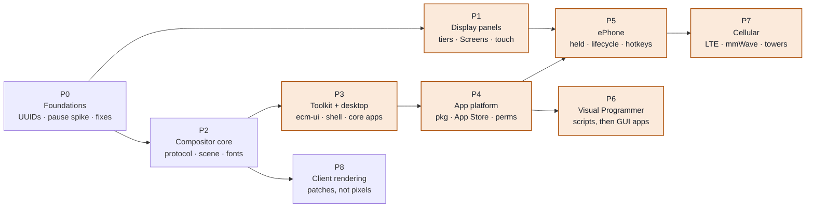

# GUI, Apps and ePhone Roadmap — EvansComputerMod

feature/gui-engine · 1.21.1

## Overview

Nine phases that take ECM from today's single-owner display to a swappable desktop, an App Store, ePhones and player-run cell networks. Each phase ships something you can test on its own, and the order follows real dependencies. The details live in [Display Pipeline](DISPLAY_PIPELINE.md) and [UI Protocol](UI_PROTOCOL.md).

**Phases**

- [Dependency map](#dependency-map)
- [P0 · Foundations](#p0--foundations)
- [P1 · Display panels](#p1--display-panels-and-tiered-screens)
- [P2 · Compositor core](#p2--compositor-core)
- [P3 · Toolkit, desktop, apps](#p3--toolkit-desktop-and-core-apps)
- [P4 · App platform](#p4--app-platform)
- [P5 · ePhone](#p5--ephone)
- [P6 · Visual Programmer](#p6--visual-programmer-as-an-app)
- [P7 · Cellular](#p7--cellular)
- [P8 · Client rendering](#p8--client-side-rendering)
- [Testing approach](#testing-approach)

## Dependency map

*Start on the left, later on the right. Amber phases ship something players see. P1 and P2 can run in parallel after P0, and so can P6 and P7 later. P8 is an optimisation that can land any time after P2. Cell towers and modems from P7 also work on Terminals, so most of P7 could start alongside P5.*

| Phase | Size | Needs | What players get |
| --- | --- | --- | --- |
| P0 Foundations | M | — | Faster, smoother screens |
| P1 Display panels | M | P0 | Panel tiers, tiered Screens, touch walls |
| P2 Compositor core | XL | P0 | A `gui` command with windows (only legacy programs at first) |
| P3 Toolkit + desktop | XL | P2 | A real desktop with Terminal, Files, Settings and Editor |
| P4 App platform | L | P3 | App Store, permissions, open with |
| P5 ePhone | XL | P1, P4 | The phone |
| P6 Visual Programmer | L | P4 | Build GUI apps without code |
| P7 Cellular | L | P5 (SIM slot) | LTE, mmWave, cell towers, carriers |
| P8 Client rendering | L | P2 | Crisp text, low bandwidth, cheap phone mirroring |

Sizes are relative effort: M is a focused branch, XL is several PRs. They aren't time estimates.

## P0 · Foundations

`size M` · `internal + perf`

**Goal:** Remove the blockers every later phase runs into, and settle the riskiest unknown early.

### Work

- **Address computers by UUID.** Rekey `TerminalDeltaPacket`, `TerminalInputPacket`, `MouseInputPacket`, `TerminalReadyPacket` and the visual-editor packets by computer UUID plus a display id. The client display cache becomes keyed by UUID too. Range checks go through the host, not a `BlockPos`.
- **Remove the `TerminalBlockEntity` casts** from `ComputerInstance` (11 today) and move those features behind `IComputerHost` capabilities: screen display, mouse capture, GUI state.
- **Modules without a block.** `IModuleHost` exposes a `Pose` instead of `getPos()`, which the Wi-Fi module's `updatePose()` already almost uses.
- **Pause spike.** Pause and resume a running child process mid-loop in both Wasmtime and Chicory, without killing it. Write up the approach, or the fallback if one runtime can't do it.
- **Pipeline fixes** from the deep dive:
  - Single-buffered blits scan out only the rect that changed.
  - One delta per frame, shared by every viewer.
  - The client uploads only changed texture regions.
  - The text flags (bold, underline, inverse) get rendered.

### Done when

- [ ] No packet or module API takes a `BlockPos` to identify a computer. Existing GameTests still pass.
- [ ] A small GameTest pauses a looping child for 1 s and resumes it with its state intact, on both runtimes.
- [ ] A program doing 40 small single-buffered blits causes 40 small copies, not 40 full frames (unit test on `DisplayDevice`).
- [ ] Two players watching one Screen cause one delta build (counter in a test).

### Risk

If Chicory can't pause safely, phone suspend falls back to *kill and restore* (§11 of the protocol). The UX is the same; the cold start is slower.

## P1 · Display panels and tiered Screens

`size M` · `players see it` · `parallel with P2`

**Goal:** Resolution becomes an in-game upgrade, and it works in console mode, so it's useful before any GUI exists.

### Work

- **Items:** Phosphor (T1), Color LCD (T2) and HD (T3) panels, with vanilla recipes, each made from the tier below. Each panel carries its mode list.
- **Panel slot on the Terminal:** right-click the face to swap. Stored as a data component next to `installed_modules`. With no panel, the computer runs headless.
- **Console resize.** `framebuffer.rs` and `vte.rs` accept any grid up to the tier maximum; a resize event reaches the kernel; the shell redraws. `TERMINAL_WIDTH/HEIGHT` are no longer constants.
- **Per-tier limits:** `DisplayDevice` limits and the `SCREEN_*` sizes come from the tier; `gfx_info` reports modes; Phosphor renders as a 2-tone palette.
- **Tiered Screen blocks.** A mixed wall runs at its lowest tier, and the tooltip names the block holding it back. Tier 3 adds **touch**: clicking a wall sends mouse events to the computer, made possible by P0's UUID input path.
- **Migration:** existing Terminals and Screens become Tier 2. New Terminal recipes include a Tier 1 panel.
- Server config caps for each tier; block models with a different bezel and tint per tier.

### Done when

- [x] Swapping T2 → T1 → T3 on a running Terminal resizes the shell with no reboot (GameTest reads the text grid size). (`ecm_panel`)
- [x] An old world loads with every Terminal and Screen at Tier 2. (`ecm_panel`)
- [x] A 2×2 wall of mixed tiers reports the lowest tier's resolution. (`ecm_panel`)
- [x] Clicking a Tier 3 wall delivers a `mouse_poll` event with the right pixel. (`ecm_panel`)

## P2 · Compositor core

`size XL` · `mostly internal` · `parallel with P1`

**Goal:** The whole UI protocol working end to end and drawn by the server, proven with legacy programs and a minimal test shell.

### Work

- **Wire format:** a new `ecm-ui-proto` Rust crate (message types and codec) and a matching Java codec, checked against **shared test vectors** so they can't drift.
- **Host calls:** `ui_open / send / recv / put_pixels / upload` in `WasiFunctions`; the UI fd added to `sock_poll` and `poll_oneoff`; `abi/child-abi.toml` section and `check-abi.py`; simulator stubs.
- **Compositor** (`computer/ui/`): connections, scene with layers, surfaces (tree and pixels), configure/ack/commit, frame pacing, resources, limits, protocol errors.
- **Java rasterizer:** all six node types, alpha, clipping, whole-number scaling. It renders the damaged region into `TerminalDisplay`.
- **Fonts:** draw the proportional `ui` font, generate its metrics table, and package `ui` and `mono` for Rust and Java.
- **Input router:** pointer hit-testing with `hit_id`, focus, keys as HID codes, typed text, and chords.
- **Shell role** and window-management messages, plus **safe mode** with restart backoff.
- **Legacy compat:** `gfx_init2` in GUI mode makes a pixel window, and `mouse_poll` is mapped into it.
- **Modes:** the `gui` command, `/etc/ui.toml`, and the console/GUI switch chord.
- Move the protocol spec into the repo as `docs/gui/UI_PROTOCOL.md`.

### Done when

- [x] `gui` starts a bare test shell that tiles windows. `gba` and `waterfall` run unchanged in windows side by side. (`GuiKernelTest`, GameTest `ecm_gui`)
- [x] Killing the shell enters safe mode, and the shell comes back within 1 s. (first restart after 0.5 s; measured ~0.53 s on Chicory)
- [x] **Golden images:** recorded protocol sessions replayed through the rasterizer match checked-in PNGs, pixel for pixel. This runs as a fast JUnit test with no game. (`UiGoldenTest`)
- [x] The chord switches between console and GUI, and both keep running.
- [x] A malformed message or broken limit closes only that app's connection. (`UiCompositorTest`, and the control case of `gui_basics`)

Not built in P2: a Screen cluster with its own compositor (`[screen] mode = "own"` behaves like `mirror`), and the simulator's `ui_*` calls still return -4.

## P3 · Toolkit, desktop and core apps

`size XL` · `players see it`

**Goal:** A desktop that someone who doesn't program can use: windows, a taskbar, and the core apps.

### Work

- **`ecm-ui` (Rust):**
  - Widgets: label, button, text field, list, scroll view, checkbox, toggle, slider, tabs, menu, dialog, image, canvas.
  - Layout: row, column, stack and grid, switching on size class.
  - Theme as data, text wrapping, and diffing to tree operations.
- **Python `ui` module:** a native module over the same Rust code, following the `_peripheral` pattern.
- **Desktop shell** `dev.ecm.desktop`: taskbar, launcher, title bars, a window switcher chord, notification toasts, and the default theme.
- **Terminal app:** a terminal emulator over `ipc_spawn_shell` / `session_resize`. It reuses the kernel's VTE logic as a shared crate if that's practical.
- **Files**, **Settings** (Wi-Fi with the one-step join, display and panel info, shell and theme choice) and the **Text Editor**.
- **Services:** clipboard and notifications.
- Lifecycle on Terminals: PC-style, so minimized windows get no `Frame` events.

### Done when

- [ ] A fresh Terminal with `autostart` boots to the desktop. You can join Wi-Fi in Settings without typing a command.
- [ ] The Python and Rust versions of the same sample app produce identical tree operations (test).
- [ ] One Settings app lays out correctly at compact, medium and wide (golden images at three sizes).
- [ ] Copy in the Editor and paste in the Terminal app works.
- [ ] Swapping the theme in Settings restyles every open app live.

## P4 · App platform

`size L` · `players see it`

**Goal:** Apps become things you install, trust and share, and the App Store runs on the in-game network.

### Work

- **Package format:** `.ecmpkg` with `app.toml`. Installed apps go in `/apps/<id>`.
- **App manager** (Java): launches apps with an identity that child processes inherit, and keeps a permission database.
- **Permission checks** in the `sock_*`, `wifi_*`, `periph_*` and WASI path host calls, with prompts through the shell. Terminal commands stay unconfined.
- **`pkg` CLI:** `repo add`, `search`, `install`, `remove`, `update`. Repositories are HTTP + `index.json`, and packages can optionally be signed.
- **App Store app** over the same index, with screenshots, install and update.
- **Repository hosting:** any computer can run `pkg serve` on top of `httpd`.
- **File picker** with one-file grants, and **"open with"** with defaults in Settings.
- **State save and restore:** `WillSuspend` → `SaveState` → `Restore`, used on Terminals at shutdown and reboot.

*Core landed (`gui/p4-appcore`): package format, `pkg` and `pkg serve`, the app manager, permission checks, grants and defaults, state storage and the ePhone background scheduler; see [APPS.md](APPS.md). The App Store app, permission dialog, file picker and chooser wait for the compositor and desktop.*

### Done when

- [ ] Computer A serves a repository. Computer B finds and installs an app over Wi-Fi from the App Store (two-computer GameTest, in the style of the radio scenarios).
- [ ] An app without `network` gets a prompt; denying it makes `sock_open` fail.
- [ ] A child process spawned by an app has the same permissions as the app.
- [ ] Double-clicking a `.py` file in Files opens the Editor, which can read only that file.
- [ ] Notes keeps its content across a server restart.

## P5 · ePhone

`size XL` · `players see it`

**Goal:** A phone you hold in either hand while you play, running a phone shell with iPhone-style lifecycle rules.

### Work

- **Item and host:** the ePhone item carries a computer UUID. A held-item host (built on P0) is live while the phone is in the hotbar. Duplicated items share one computer, as decided.
- **Slots:** a panel, 2 modules (Wi-Fi installed by default) and a SIM slot. There's a phone-sized UI for slotting them.
- **States:** awake when held, asleep in the hotbar with refresh wakes, off anywhere else. Uses the P0 pause path, or kill and restore.
- **Rendering in first person:** the phone's display drawn on the model in your main hand or offhand, streamed only to its holder.
- **Visibility to others:** server maximum (off / glow / full), each player's share toggle, and each player's "render others" toggle.
- **Input:** open mode gets every key; in-hand mode gets 6 hotkey slots plus the "switch app" chord. Controls entries are unbound by default and movement keys are never taken. Reuses the gamepad's client code.
- **Phone shell** `dev.ecm.phone`: home grid, status bar (signal, battery, background-mode indicators), notification sheet, app switcher.
- **Lifecycle:** refresh wakes on a budget and background exception modes.
- **Battery** (configurable) with a vanilla-recipe charging dock.
- **GBA app:** touch buttons on screen, the full keyboard in open mode, and a paired Wireless Controller.
- The Wi-Fi module tracks the player's position, using the existing handheld-radio pattern.

### Done when

- [ ] Holding the phone in the offhand while walking shows its screen. Pressing hotkey slot 1 reaches the open app, and W still walks. (Hardware done: client suite `phone` shows the screen in the off hand and walks with slot 1 on W; the hotkey reaches the computer as a `phone_hotkey` event until the compositor routes it to the open app.)
- [x] Moving the phone out of the hotbar and back resumes the app in the same state (GameTest). (`ecm_phone` `phone_basics`, a running program)
- [ ] A refresh wake posts a notification while the phone sits in the hotbar, and gets cut off after its budget.
- [ ] Music keeps playing in the background under the audio exception.
- [x] With the server set to "glow only", other clients get no pixels for your screen. (`phone_visibility`)
- [x] Walking away from an access point drops Wi-Fi at the expected range. (`phone_wifi_walk`: range set by a stone wall and checked against `/ecm radio link`; see EPHONE.md)

## P6 · Visual Programmer as an app

`size L` · `players see it` · `parallel with P7`

**Goal:** The no-code path for building GUI apps, from a blank canvas to a published app.

### Work

- **Step 1, port:** rebuild `VisualProgrammingScreen`'s node canvas as an `ecm-ui` app, using `line` nodes for wires. It saves through the file system and runs scripts as normal processes.
  - Delete `OpenVisualEditorPacket`, `RunVisualScriptPacket` and the injected keystrokes.
  - Existing `.vpl` files still open.
- **Step 2, GUI designer:** a drag-and-drop screen editor that writes `.ui.json`. A control's events become entry points in the node graph, and a preview runs in a window.
- **Step 3, publish:** package the app (manifest, icon, permissions inferred from the blocks used) and push it to your repository.

As built: [Visual Programmer](VISUAL_PROGRAMMER.md). Old `.vpl` samples generate the old generator's Python byte for byte and run as `python` processes (console and `ecm_visual` GameTest); the editor window and the App Store install wait for the compositor (P2) and `pkg` (P4).

### Done when

- [ ] An old `.vpl` opens and runs in the new app with the same output.
- [ ] A designer-built app with a button that increments a label installs on a second computer from the App Store and works.
- [x] The old Java screen and its packets are gone.

## P7 · Cellular

`size L` · `players see it` · `most can start with P5`

**Goal:** Players build cell networks and run carriers, and phones roam across them.

### Work

- **Radio PHY profiles:** LTE at about 700–900 MHz (UHF band) and mmWave at about 28 GHz (microwave band). Each gets its own link budget, rates and channel plan in the existing medium.
- **Modem modules:** LTE and mmWave. They work in Terminals and ePhones and show up to the kernel as a network interface.
- **SIM card item:** holds a carrier ID and credentials. It goes in the phone's SIM slot, or in the modem module when used in a Terminal.
- **Cell tower:** a base-station block, LTE and/or mmWave antennas on a mast (antenna solver), and a cable back to a network.
  - Attach is automatic for a matching carrier.
  - Handover between towers reuses the same-SSID roaming from the access point.
- **Carrier tools:** issue SIMs at the tower, list attached devices, set data limits.
- **On the phone:** a Cellular pane in Settings and signal bars in the status bar.

### Done when

- [ ] A phone with a matching SIM attaches to a tower 300 blocks away over LTE and can reach the internet through the tower's backhaul.
- [ ] A mmWave link works in line of sight and fails behind a hill (path-loss test).
- [ ] Walking between two towers of the same carrier hands over without dropping a TCP connection.
- [ ] A SIM from carrier A doesn't attach to carrier B's tower.

## P8 · Client-side rendering

`size L` · `optimisation` · `any time after P2`

**Goal:** Send scene and tree patches instead of pixels: crisp text, much less bandwidth, and cheap phone mirroring.

### Work

- **Packets:** scene and tree patches keyed by computer UUID and display, scene keyframes for players who join late, and resources cached by hash.
- **On the client:** mirror the scene and run the **same Java rasterizer** at the panel's resolution, uploading only the parts that changed (phase 2a).
- **Animations:** the client runs shell transitions locally.
- **Pixel surfaces** keep the tile diff, per surface.
- **Phase 2b, GPU rendering:** only if profiling says 2a is too slow.

### Done when

- [x] The client's output is identical to the server's for every golden session (test). (`UiClientRenderTest`: every snapshot, following the stream and from a keyframe; in-world `gui_client_render`)
- [x] Typing in the Editor sends under 1 KB/s to a watching player (byte counter). (`UiClientRenderTest` scripted editor at 10 keys/s; Notes in `gui_client_render` at 8 keys/s)
- [x] A Tier 3 wall showing the desktop costs less bandwidth than a Tier 2 wall does today. (`UiClientRenderTest`: the test shell desktop session)

**As built:** phase 2a, see [UI_PROTOCOL §17](UI_PROTOCOL.md#17--as-built-p8-client-rendering). Phase 2b (GPU) not started.

## Testing approach

This follows your mod-testing rules: implement first, then targeted tests only, with in-game time under a minute per test.

- **Protocol and rendering tests run without the game.** Codec test vectors, the compositor and rasterizer against golden PNGs, and `ecm-ui` layout at three size classes all run as JUnit or `cargo test`. Most of P2, P3 and P8 is checked here.
- **GameTests only for world behaviour:** panel swaps, Screen walls, held-phone states, two-computer App Store installs, cell towers. Each is a small, focused scenario.
- **Simulator stubs** for the `ui_*` calls keep the existing Rust simulator tests running.
- **Every phase ends with a built 1.21.1 jar** in the repo root for hands-on play.

> **Suggested first step:** start P0 with the **pause spike**. It's the one unknown that could change the ePhone design, and it's small. The UUID rekeying can run alongside it.
