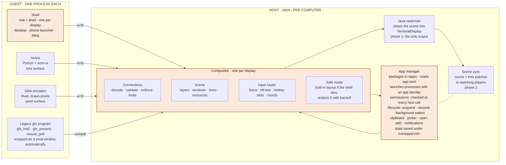
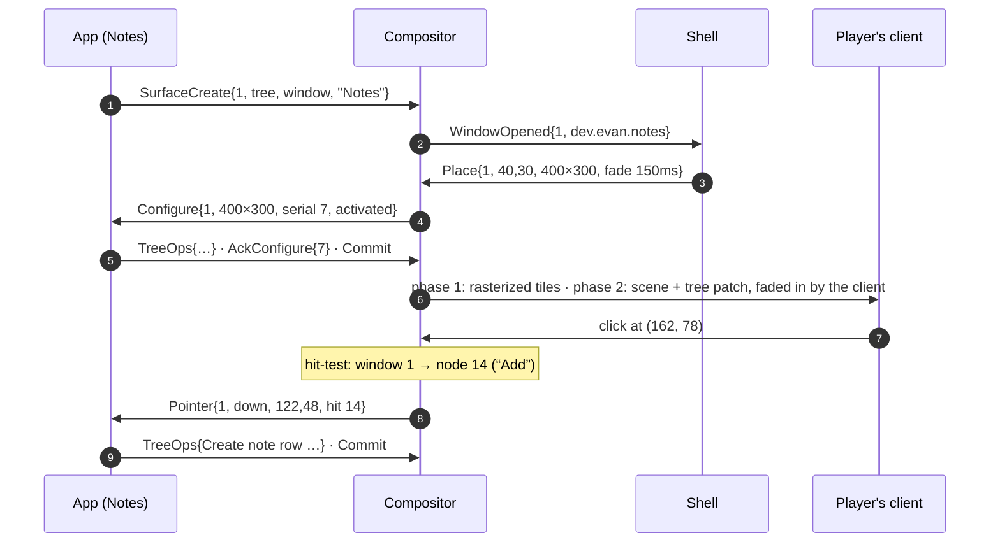

# UI Protocol — EvansComputerMod

feature/gui-engine · draft 0.1

## Overview

How apps, the swappable shell and the Java compositor talk to each other. The design follows the decisions in [Display Pipeline](DISPLAY_PIPELINE.md). All names, numbers and limits are proposals until implementation settles them.

**Contents**

1. [The pieces](#1--the-pieces)
2. [Console and GUI modes](#2--console-and-gui-modes)
3. [Transport](#3--transport)
4. [Displays and units](#4--displays-and-units)
5. [Surfaces](#5--surfaces)
6. [Display-list trees](#6--display-list-trees)
7. [Input](#7--input)
8. [Shell protocol](#8--shell-protocol)
9. [Opening a window](#9--opening-a-window-end-to-end)
10. [Apps and permissions](#10--apps-and-permissions)
11. [Lifecycle](#11--lifecycle)
12. [Shared services](#12--shared-services)
13. [ecm-ui toolkit](#13--ecm-ui-toolkit)
14. [Getting it to players](#14--getting-it-to-players)
15. [Risks and open items](#15--risks-and-open-items)

## 1 · The pieces

Four parts, each with one job:

- **Apps** own windows and draw into them.
- The **shell** decides where windows go and draws the desktop around them.
- The **compositor** enforces the rules, stacks windows into the display, and routes input.
- The **app manager** knows which process is which app, and what each app may do.

Apps and the shell are guest programs. The compositor and app manager run in Java, one of each per computer.



*Every guest connection is a single file descriptor. The shell sees window metadata but never app content. Legacy programs that call `gfx_init2` while the GUI is running get a pixel window made for them.*

## 2 · Console and GUI modes

- **Console mode is the default for Terminals,** and it's exactly today's behaviour. The kernel owns the display, no compositor exists, and the `ui_*` calls return `-4` (no such device).
- **Starting the GUI:** the `gui` command, or `autostart = true` in `/etc/ui.toml`, asks the host to start a compositor. The compositor takes the Terminal display from the kernel and launches the configured shell.
- **Switching:** a key chord (proposed <kbd>Ctrl</kbd>+<kbd>Alt</kbd>+<kbd>Backspace</kbd>) flips the display between the console and the GUI, like switching virtual terminals. Both keep running, and only the visible one gets input.
- **ePhones are always in GUI mode.** The console is reachable through the Terminal app.
- **Screen clusters** can run their own compositor with their own shell (kiosk, dashboard), or mirror the Terminal's.

```toml
# /etc/ui.toml
autostart = false
shell     = "dev.ecm.desktop"      # an installed app id with the shell role
theme     = "ecm-default"

[screen]                           # the attached Screen cluster
mode      = "mirror"               # "mirror" | "own" | "off"
shell     = "dev.ecm.kiosk"        # used when mode = "own"
```

## 3 · Transport

The protocol is a stream of small binary messages over a **UI file descriptor**. That needs only five host functions. Wire format, versioning and simulator stubs then all live in one place, and a recorded session can be replayed for tests. Bulk pixels skip the message stream and take one copy straight from program memory.

```toml
# abi/child-abi.toml, new section
[imports.ui]
ui_open       = { params = ["i32", "i32"], results = ["i32"],
                  doc = "(role, version) role 0 = app, 1 = shell -> fd. -4 console mode, -2 shell taken, -6 not permitted" }
ui_send       = { params = ["i32", "i32", "i32"], results = ["i32"],
                  doc = "(fd, buf, len) one or more whole messages -> 0, or a negative protocol error" }
ui_recv       = { params = ["i32", "i32", "i32", "i32"], results = ["i32"],
                  doc = "(fd, buf, cap, timeout_ms) -> bytes of whole messages, 0 timeout, -5 interrupted" }
ui_put_pixels = { params = ["i32", "i32", "i32", "i32", "i32", "i32"], results = ["i32"],
                  doc = "(fd, target_id, buf, len, damage_ptr, n_rects) rows in the target's format; damage = n x (i32 x,y,w,h)" }
ui_upload     = { params = ["i32", "i32", "i32", "i32", "i32"], results = ["i32"],
                  doc = "(fd, resource_id, kind, buf, len) kind 0 = PNG image, 1 = raw RGBA (w,h from ResourceCreate)" }
```

- **One event loop.** The UI fd works with `sock_poll` and WASI `poll_oneoff`, so an app can wait on window events, sockets and timers together.
- **Framing:** `u16 opcode · u16 flags · u32 length · body`, little-endian, like the rest of the ABI. Strings are `u32 len + UTF-8`; arrays are `u32 count + items`.
- **Versioning:** the first message each way is `Hello{version, role, capabilities}` / `Welcome{version, display, theme}`. Unknown opcodes are a protocol error. New features are added as named capabilities, not by changing existing messages.
- **Errors:** a malformed message, a broken limit or an unknown object id ends the connection with `Error{code, message}`, the way Wayland does. The app's windows disappear; the process is not killed.
- **Where it's implemented:** Java in `WasiFunctions` plus a new `computer/ui/` package; Rust wrappers in `ecm-host-abi::ui`; stubs in `rust/simulator`; the version recorded in both ABI files and checked by `scripts/check-abi.py`.

## 4 · Displays and units

Everything in the protocol is in **logical units** (lu). A display reports its logical size, a **scale** (device pixels per lu), and a **size class** that apps use for layout. The installed panel tier decides the device pixels.

| Device · tier | Device pixels | Scale | Logical size | Size class |
| --- | --- | --- | --- | --- |
| Terminal · Tier 1 | 320×200 | 1 | 320×200 | compact |
| Terminal · Tier 2 | 640×400 | 1 | 640×400 | medium |
| Terminal · Tier 3 | 1280×800 | 2 | 640×400 | medium |
| ePhone · Tier 1 / 2 / 3 | 120×200 / 240×400 / 480×800 | 1 / 1 / 2 | 120×200 / 240×400 / 240×400 | compact |
| Screen wall · any tier | from cluster shape | 1 or 2 | device ÷ scale | by width |

- **Size classes:** compact < 400 lu wide, medium 400–799, wide ≥ 800. `ecm-ui` layouts switch on these, so one app fits a phone and a wall.
- **Tier 3 doubles pixels rather than space.** The same layout gets sharper instead of tinier, which is why Tier 3 Terminals report scale 2.
- **Pixel surfaces** pick their own pixel size and scale. The compositor scales them by whole numbers only, so they stay sharp.
- **Panel hot-plug** sends `DisplayChanged` to the shell, which re-places windows and sends `Configure` to every app.

## 5 · Surfaces

A surface is one rectangle of content. It has a **kind**, which says what it holds, and a **role**, which says where it can go.

### Kinds

- **tree**: a display-list tree (§6). Used by `ecm-ui` apps and shells.
- **pixels**: a pixel buffer in INDEXED8, RGB565 or RGBA8888, filled with `ui_put_pixels`. Used by emulators, video, canvases and legacy programs.

### Roles

- **window**: an ordinary app window.
- **popup**: menus and tooltips anchored to a parent window. Closed when you click outside it.
- **layer** (shell only): `background`, `bottom`, `top` or `overlay`, for wallpaper, taskbar, status bar and notifications.

Stacking order, bottom to top: `background` → `bottom` → windows → `top` → popups → `overlay`. A fullscreen window covers `top` but not `overlay`.

### Changes are atomic: configure, ack, commit

1. The compositor sends `Configure{surface, serial, w, h, states}`. States are `activated · maximized · fullscreen · suspended`.
2. The app redraws at that size, then sends `AckConfigure{serial}` and `Commit`.
3. Nothing the app changes becomes visible until `Commit`, so players never see half a frame.

### Frame pacing

An app that wants to animate sends `RequestFrame{surface}` and gets `Frame{surface, time_ms}` at the display's next refresh, **only if the surface is visible**. Hidden or covered apps get no frame events, so they naturally stop drawing. This is most of the battery and CPU saving.

## 6 · Display-list trees

A tree surface holds a **retained tree of nodes**. Each node has an id unique within its surface. Apps send changes as operations, and the compositor applies them all at `Commit`.

```text
TreeOps{surface, ops: [
  Create{id, parent, index, kind, props}     # insert a node
  Set{id, props}                             # change some props
  Move{id, parent, index}
  Remove{id}                                 # and its children
]}
```

| Node | Props | Notes |
| --- | --- | --- |
| `group` | x, y, clip (w,h), opacity, scale, hit_id | Positions its children. The only node that clips. |
| `rect` | x, y, w, h, fill, radius, border_w, border_color, hit_id | Backgrounds, buttons, dividers. Alpha allowed in every color. |
| `text` | x, y, string, font, size, color, hit_id | A **single line**. `ecm-ui` wraps text and emits one node per line, so layout is decided in the guest. |
| `image` | x, y, w, h, resource, src rect, sampling (nearest/linear), tint | Icons and pictures. Uploaded once with `ui_upload`. |
| `canvas` | x, y, w, h, resource, scale | A pixel buffer inside a tree, e.g. a game view in an app with buttons. Fed by `ui_put_pixels`. |
| `line` | points (≤ 256), width, color | Graphs and connectors, e.g. wires in the Visual Programmer. |

### Fonts are part of the protocol

The guest lays out text, so every renderer must measure glyphs identically. ECM ships two fonts with **fixed metrics tables**, compiled into `ecm-ui`, the Java rasterizer and the client:

- `ui`: a proportional pixel font, sizes 8–32 lu.
- `mono`: today's 8×16 terminal font, at multiples of its size.

Resource packs can't change them. Missing glyphs draw as a fixed-width box. `Welcome` carries a metrics version so a mismatch is caught at connect time.

### Resources

Each connection has its own resources. `ResourceCreate{id, kind, w, h, format}` declares one, and the data is sent with `ui_upload` (images) or `ui_put_pixels` (canvases). Images are content-hashed. In phase 2 a client that already has an image's hash never downloads it again.

### Limits (per app, server-configurable)

- 8,192 nodes per surface; 32,768 per app.
- 4 KB of text per node.
- 8 MB of resources per app.
- 256 KB/s of tree operations. Above that, commits are merged until the next refresh rather than rejected.
- Pixel surfaces no larger than the display's device size.

## 7 · Input

The compositor routes every event. Apps only receive input for their own surfaces, in surface-local logical units.

| Event | Fields | Goes to |
| --- | --- | --- |
| `Pointer` | surface, kind (enter, leave, move, down, up, scroll), x, y, buttons, **hit_id** | The surface under the pointer, or the one that grabbed it on `down` |
| `Key` | surface, key (USB HID usage), mods, down/up, repeat | The focused surface |
| `Text` | surface, UTF-8 | The focused surface; typed characters, separate from keys |
| `Focus` | surface, gained/lost | Both surfaces involved |
| `Hotkey` | slot 1–6, down/up | The app whose window is open (ePhone in hand) |
| `Chord` | chord id | The shell, for chords it bound (§8) |

- **Hit ids skip app-side hit-testing.** Any node can carry a `hit_id`. The compositor finds the topmost hit node under the pointer and includes its id in the event, so `ecm-ui` maps a click straight to a widget. This keeps working when trees are drawn on the client.
- **Keys use USB HID usage codes,** not Minecraft key names. Programs never depend on GLFW or the player's keyboard layout. Typed characters arrive separately as `Text`.
- **ePhone input modes** follow the decisions:
  - **Phone open:** the full keyboard, with the mouse acting as touch.
  - **In hand while playing:** only `Hotkey` slots 1–6 plus the shell's "switch app" chord.

  Apps declare their slots with `HotkeyClaim{slot, label}`. The label is what the player sees in the Controls screen.
- **Mouse capture** (pointer lock for games) is `PointerLock{surface}`. It's granted only to the focused window while the phone or Terminal is open, and Escape always releases it.

## 8 · Shell protocol

A connection opened with `role = shell` gets everything an app gets, plus window-management messages. The shell can make its own surfaces with the `layer` role. It sees each window's metadata, **never its content**.

### Compositor → shell

- `WindowOpened{id, pid, app_id, title, icon, min/max size, parent}`
- `WindowChanged{id, title, …}` · `WindowClosed{id}`
- `WindowRequest{id, move | resize | minimize | maximize | fullscreen | activate}`
- `DisplayChanged{size, scale, class, tier}`
- `Chord{id}`
- `PermissionPrompt{req, app_id, permission}`
- `NotificationPosted{nid, app_id, title, body, icon, actions}`

### Shell → compositor

- `Place{id, x, y, w, h, states, transition}`
- `Stack{ids bottom→top}` · `Focus{id}`
- `SetVisible{id, bool}` · `SetOpacity{id, a, transition}`
- `BindChord{id, keys}` (e.g. switch app, launcher)
- `AnswerPermission{req, allow, remember}`
- `Launch{app_id, args}` · `CloseWindow{id}`
- `SetTheme{theme}`, broadcast to every app

Further rules:

- **Animations are declarative.** `transition = {ms, easing}` on a placement or opacity change lets the renderer animate between frames at the display's refresh rate. The shell doesn't send 60 updates a second, and in phase 2 the client animates smoothly with no network traffic.
- **The shell sets the theme.** A theme is data: colors, corner radii, font sizes, spacing. `ecm-ui` draws every widget from it, so swapping shells changes the look of every app, not only the desktop.
- **Safe mode.** If the shell exits, crashes or stops answering for 5 s, the compositor takes over with a built-in layout: focused window maximized, a fixed switch-app chord, and a plain text bar. It restarts the shell after 1 s, then 5 s, then 30 s. A broken shell never makes a computer unusable.

## 9 · Opening a window, end to end



*The shell takes part only in steps 2–3, and only sees metadata. The window appears on the first `Commit` after `AckConfigure`. Clicks are resolved to a node on the server, so the app never does hit-testing.*

## 10 · Apps and permissions

- **Installed apps live in `/apps/<app_id>/`**, unpacked from an `.ecmpkg` with the `app.toml` manifest from [Display Pipeline](DISPLAY_PIPELINE.md#package-format-proposed). The app manager indexes them at boot and whenever `pkg` installs one.
- **An app's identity is attached to its process.** The app manager starts every app, so it knows each process's app id. Child processes inherit that id, so an app can't escape its permissions by spawning a helper.
- **Commands typed in the Terminal are not apps.** They run unconfined, like today and like command-line tools on a PC. Only packaged apps are sandboxed. That keeps scripting simple and makes App Store apps safe.
- **Permissions are checked in Java** at the host-call boundary, which guest code can't bypass. The first use triggers a `PermissionPrompt` that the shell shows. Answers are remembered per app and can be reviewed in Settings.

| Permission | Covers | Checked in |
| --- | --- | --- |
| `network` | Sockets, DNS, HTTP | `sock_*` |
| `radio` | Raw Wi-Fi frames, SDR, transmitting | `wifi_*`, radio peripherals |
| `cellular` | Using the cellular modem directly | modem peripheral |
| `peripherals:<type>` | One peripheral type, e.g. `peripherals:redstone_link` | `periph_*` |
| `files:documents` / `files:all` | Shared documents / the whole disk. An app's own `/var/apps/<id>` is always allowed, and picked files are granted one at a time (§12) | WASI path calls |
| `controller` | Paired Wireless Controllers | controller peripheral |
| `location` | Player position and heading on an ePhone | location service |
| `notifications` | Posting notifications | compositor |
| `background:<mode>` | `refresh`, `audio`, `radio`, `transfer`, `navigation` | app manager |

## 11 · Lifecycle

The device sets the policy. **ePhones follow iPhone rules. Terminals behave like a PC:** apps keep running, and minimized windows stop getting `Frame` events. This split is decided.

| State | When (ePhone) | CPU |
| --- | --- | --- |
| Foreground | The app is on screen and the phone is awake (held) | Unlimited, with `Frame` events |
| Suspended | Switched away, or the phone is asleep or off | None. The process is paused in memory |
| Refresh wake | Every 5 min while the phone is in the hotbar (configurable) | Up to 2 s of run time, then suspended again. The app calls `BackgroundDone` to finish early |
| Exception mode | A declared and approved `background:<mode>` that is actually in use (audio playing, a download running) | Capped at 10% of a core; status-bar indicator |
| Terminated | Logout, restart, memory pressure, or a long suspend | None; relaunched cold |

Before any suspend, the app gets `WillSuspend{deadline_ms: 500}` and saves its state with `SaveState{bytes}`, which is kept under `/var/apps/<id>/state`. After a cold start it gets `Restore{bytes}` before its first `Configure`. That's how phones look like they "resume where they left off" across restarts. The limits are documented in [Display Pipeline](DISPLAY_PIPELINE.md#suspend-and-resume-how-it-works-and-its-limits).

## 12 · Shared services

All four are messages on the same UI connection. The compositor and app manager handle them, so no extra daemons are needed.

- **Clipboard.** `ClipboardSet{mime, bytes}` from any app. `ClipboardRequest{mime}` is answered only if the request comes right after a paste key or click in that app's own focused window. Background apps can't read the clipboard.
- **Notifications.** `Notify{title, body, icon, actions[], tag}` needs the `notifications` permission. The shell decides how to show it. Tapping an action sends `NotificationAction{nid, action}` back to the app, launching it first if needed.
- **File picker.** `PickFile{mode: open | save, types[], suggested}` opens a picker drawn by a system component, not by the app. The answer is `FilePicked{path}`, and the app is granted access to **that one file** even without a `files:*` permission. This is the same idea as Linux desktop portals.
- **Open with.** Apps list file types in `open_with`. `Open{path}` from Files or any app launches the default handler, or shows a chooser when there are several. The handler gets `OpenFile{path}` with a one-file grant. Defaults are set in Settings.

## 13 · ecm-ui toolkit

`ecm-ui` is a Rust crate with widgets, layout (rows, columns, stacks, grids, scroll views), theming, text wrapping and diffing to tree operations. **Python uses the same Rust code** through a native module, the way `_peripheral` and `_radio` already work. Layout and diffing never run in the Python interpreter, and both languages behave identically.

### Python

```python
import ui

app = ui.App("dev.evan.notes")
notes = app.restore().get("notes", [])
entry = ui.TextField(placeholder="New note")
rows = ui.List()

def add(_=None):
    if entry.text:
        notes.append(entry.text)
        entry.text = ""
        rows.items = [ui.Label(n) for n in notes]

app.window("Notes", ui.Column(gap=8, padding=12, children=[
    ui.Row(gap=8, children=[entry,
        ui.Button("Add", on_click=add)]),
    rows,
]))
app.hotkey(1, "Add note", add)
app.on_suspend(lambda: {"notes": notes})
app.run()
```

### Rust

```rust
use ecm_ui::prelude::*;

fn main() {
    let mut app = App::new("dev.evan.notes");
    let notes = app.state::<Vec<String>>("notes");
    let entry = TextField::new().placeholder("New note");

    app.window("Notes", move |cx| {
        column().gap(8).padding(12).child(
            row().gap(8)
                .child(entry.clone())
                .child(button("Add").on_click(|cx| {
                    notes.push(entry.take(cx));
                })),
        )
        .child(list(notes.iter().map(label)))
    });
    app.run();
}
```

### Layout files, for the Visual Programmer

`ecm-ui` also loads layouts from `.ui.json` files with named event handlers. The Visual Programmer edits these files in a designer view and wires each handler to a node graph that generates Python. The resulting app is an ordinary package that can be published to the App Store.

```json
{ "window": "Notes",
  "root": { "column": { "gap": 8, "padding": 12, "children": [
    { "row": { "gap": 8, "children": [
      { "textfield": { "id": "entry", "placeholder": "New note" } },
      { "button": { "text": "Add", "on_click": "add_note" } } ] } },
    { "list": { "id": "rows" } } ] } } }
```

## 14 · Getting it to players

1. **Phase 1: server rasterizes.** The Java rasterizer draws the composed scene into `TerminalDisplay`, which goes out through today's tile path. The client doesn't change.
2. **Phase 2a: client rasterizes, same code.** The server sends scene and tree patches. The client mirrors the scene and runs the *same Java rasterizer class* at the panel's resolution, then uploads only the changed regions. Server and client share one renderer, so the pixels are guaranteed identical.
3. **Phase 2b: GPU rendering, optional.** Drawing trees with Minecraft's renderer would be faster. It's only worth it if 2a turns out too slow, and golden-image tests would have to hold it to the reference rasterizer.

In every phase, late joiners get a **scene keyframe**: every surface's full tree, plus the hashes of resources they may already have. Pixel surfaces keep using the 16×16 tile diff, now per surface instead of per display.

## 15 · Risks and open items

- **Pausing a process.** Today a child process can only be killed, not paused. Suspend needs a pause hook in both runtimes: epoch interruption in Wasmtime and an instruction-count check in Chicory. Check this before building lifecycle on top of it.
- **Polling the UI fd.** `sock_poll` and `poll_oneoff` must accept the new fd type. The change is small, but both runtimes and the simulator need it.
- **Font design.** Someone has to draw the proportional `ui` font and generate its metrics table. Every renderer depends on that table.
- **The numbers.** Limits, wake intervals, budgets and timeouts are first guesses, to be tuned with real apps on a busy server.
