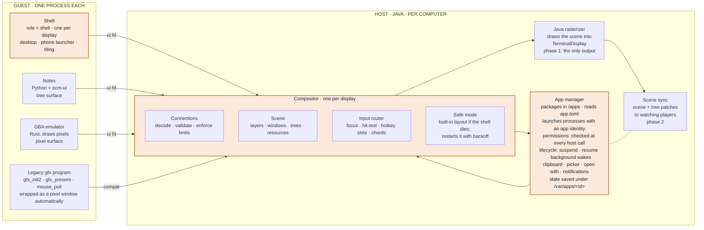
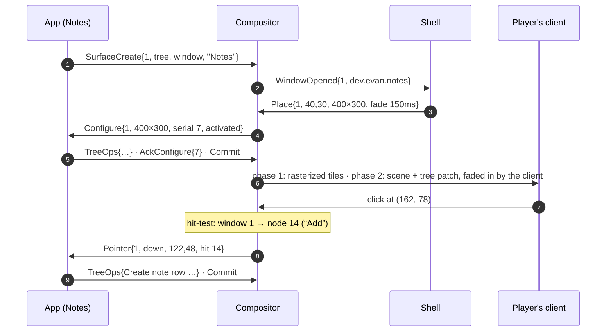

# UI Protocol — EvansComputerMod

feature/gui-engine · 0.4 (compositor core, ROADMAP P2; desktop, core apps and services, ROADMAP P3; client rendering, ROADMAP P8) · wire contract v1 frozen in [`abi/ui-protocol.toml`](../../abi/ui-protocol.toml)

## Overview

How apps, the swappable shell and the Java compositor talk to each other. The design follows the decisions in [Display Pipeline](DISPLAY_PIPELINE.md). Sections 1-9 describe what P2 built (the as-built rules are marked **as built**; [§16](#16--as-built-p2-compositor-core) lists the classes, threads and tests); services, permissions and lifecycle (§10-§12) are still mostly design.

**Contents**

1. [The pieces](#1--the-pieces)
2. [Console and GUI modes](#2--console-and-gui-modes)
3. [Transport](#3--transport)
4. [Displays and units](#4--displays-and-units)
5. [Surfaces](#5--surfaces)
6. [Display-list trees](#6--display-list-trees)
7. [Input](#7--input)
8. [Shell protocol](#8--shell-protocol)
9. [Opening a window](#9--opening-a-window-end-to-end)
10. [Apps and permissions](#10--apps-and-permissions)
11. [Lifecycle](#11--lifecycle)
12. [Shared services](#12--shared-services)
13. [ecm-ui toolkit](#13--ecm-ui-toolkit)
14. [Getting it to players](#14--getting-it-to-players)
15. [Risks and open items](#15--risks-and-open-items)
16. [As built: P2 compositor core](#16--as-built-p2-compositor-core)
17. [As built: P3 desktop and core apps](#17--as-built-p3-desktop-and-core-apps)
18. [As built: P8 client rendering](#18--as-built-p8-client-rendering)
19. [As built: P4 integration](#19--as-built-p4-integration)

## 1 · The pieces

Four parts, each with one job:

- **Apps** own windows and draw into them.
- The **shell** decides where windows go and draws the desktop around them.
- The **compositor** enforces the rules, stacks windows into the display, and routes input.
- The **app manager** knows which process is which app, and what each app may do.

Apps and the shell are guest programs. The compositor and app manager run in Java, one of each per computer.



*Every guest connection is a single file descriptor. The shell sees window metadata but never app content. Legacy programs that call `gfx_init2` while the GUI is running get a pixel window made for them.*

## 2 · Console and GUI modes

- **Console mode is the default for Terminals,** and it's exactly today's behaviour. The kernel owns the display, no compositor exists, and the `ui_*` calls return `-4` (no such device).
- **Starting the GUI:** the `gui` command, or `autostart = true` in `/etc/ui.toml`, asks the host to start a compositor. The compositor takes the Terminal display from the kernel and launches the configured shell.
  - **As built:** `gui` is a WASI program (`rust/wasm-programs/gui`) that writes one command line to the control device `/dev/uictl` and prints the answer: `gui` (= `gui start`), `gui console`, `gui show`, `gui toggle`, `gui stop`, `gui status` (one line per window), `gui launch PROG ARGS…` (a program started as a GUI app, outside the console's job control). No ABI change was needed. `autostart` is read when the computer boots.
- **Switching:** <kbd>Ctrl</kbd>+<kbd>Alt</kbd>+<kbd>Backspace</kbd> flips the display between the console and the GUI, like switching virtual terminals. Both keep running, and only the visible one gets input. **As built:** the chord works from either side; while the console is shown the GUI composites nothing and sends no `Frame` events (its apps keep running), and on the way back the whole display is redrawn. A program that draws on the console while the GUI is shown draws into a shadow frame that appears when the console comes back.
- **ePhones are always in GUI mode.** The console is reachable through the Terminal app.
- **Screen clusters** can run their own compositor with their own shell (kiosk, dashboard), or mirror the Terminal's.

```toml
# /etc/ui.toml
autostart  = false
shell      = "dev.ecm.desktop"     # an installed app id with the shell role
shell_args = ["--launch", "notes"] # as built: arguments for the shell (test-shell: apps to open)
theme      = "ecm-default"

[screen]                           # the attached Screen cluster
mode      = "mirror"               # "mirror" | "own" | "off"
shell     = "dev.ecm.kiosk"        # used when mode = "own"
```

**As built (P2, P3):** without a file the defaults are `shell = "dev.ecm.desktop"` (the P3 desktop, program `desktop`; `test-shell` is the P2 tiling shell) and `mode = "mirror"`. `gui prompt APP PERMISSION` shows the shell's permission dialog (the answer is logged and listed by `gui status`). The shell names a program the way the console does (`<name>.wasm`, `bin/`, `server-bin/`); an app id like `dev.ecm.desktop` falls back to its last segment (`desktop`) until the app manager of P4. `mirror` copies the Terminal's composited frame onto the attached Screen cluster whenever no program owns the Screen; `off` leaves the Screen to the console. `own` (a second compositor with its own shell on the Screen) is **not built yet**: it behaves like `mirror`, because `ui_open` has no way to pick a display.

## 3 · Transport

The protocol is a stream of small binary messages over a **UI file descriptor**. That needs only five host functions. Wire format, versioning and simulator stubs then all live in one place, and a recorded session can be replayed for tests. Bulk pixels skip the message stream and take one copy straight from program memory.

```toml
# abi/child-abi.toml, new section
[imports.ui]
ui_open       = { params = ["i32", "i32"], results = ["i32"],
                  doc = "(role, version) role 0 = app, 1 = shell -> fd. -4 console mode, -2 shell taken, -6 not permitted" }
ui_send       = { params = ["i32", "i32", "i32"], results = ["i32"],
                  doc = "(fd, buf, len) one or more whole messages -> 0, or a negative protocol error" }
ui_recv       = { params = ["i32", "i32", "i32", "i32"], results = ["i32"],
                  doc = "(fd, buf, cap, timeout_ms) -> bytes of whole messages, 0 timeout, -5 interrupted" }
ui_put_pixels = { params = ["i32", "i32", "i32", "i32", "i32", "i32"], results = ["i32"],
                  doc = "(fd, target_id, buf, len, damage_ptr, n_rects) rows in the target's format; damage = n x (i32 x,y,w,h)" }
ui_upload     = { params = ["i32", "i32", "i32", "i32", "i32"], results = ["i32"],
                  doc = "(fd, resource_id, kind, buf, len) kind 0 = PNG image, 1 = raw RGBA (w,h from ResourceCreate)" }
```

- **One event loop.** The UI fd works with `sock_poll` and WASI `poll_oneoff`, so an app can wait on window events, sockets and timers together. **As built:** `poll_oneoff` reports an `fd_read` subscription on a UI fd when messages are waiting (`nbytes` = bytes waiting, the hang-up flag once the connection is closed) and `fd_write` at once; `sock_poll` reports `POLLIN` / `POLLHUP` for UI fds next to the kernel's socket states (it polls the kernel in 20 ms slices while only the UI side can wake it).
- **Framing:** `u16 opcode · u16 flags · u32 length · body`, little-endian, like the rest of the ABI. Strings are `u32 len + UTF-8`; arrays are `u32 count + items`.
- **Versioning:** the first message each way is `Hello{version, role, capabilities}` / `Welcome{version, display, theme}`. Unknown opcodes are a protocol error. New features are added as named capabilities, not by changing existing messages.
- **Errors:** a malformed message, a broken limit or an unknown object id ends the connection with `Error{code, message}`, the way Wayland does. The app's windows disappear; the process is not killed. **As built:** the failing `ui_send` / `ui_put_pixels` / `ui_upload` returns -1; `ui_recv` then returns the queued `Error` and, once drained, -5 (closed). A program that leaves more than 8 MiB of messages unread is closed with `limit`.
- **Host-call details (as built).** `ui_open` returns -4 when no compositor runs, -2 when a shell is already connected, -1 for a role other than 0/1 or a version other than 1. `ui_send` takes up to 4 MiB of whole messages. `ui_recv` returns as many whole messages as fit in `cap`, -1 if the next message alone is larger than `cap`, 0 after `timeout_ms` (negative waits forever). `ui_put_pixels`: `len` must be the whole target in its format (`w × h × bytes per pixel`); only the damage rectangles (which must lie inside the target; none = all of it) are copied out of the program. `target_id` names a pixel surface if the connection has one with that id, otherwise a canvas resource. `ui_upload` takes up to 16 MiB.
- **Where it's implemented:** Java in `WasiFunctions` plus a new `computer/ui/` package; Rust wrappers in `ecm-host-abi::ui`; stubs in `rust/simulator`; the version recorded in both ABI files and checked by `scripts/check-abi.py`.

### Wire contract (v1)

Every message, its opcode, field order and types are frozen in [`abi/ui-protocol.toml`](../../abi/ui-protocol.toml). `scripts/gen-ui-proto.py` generates the Rust codec (`rust/crates/ecm-ui-proto`), the Java codec (`computer/ui/proto/UiProto.java`) and the shared test vectors (`abi/ui-test-vectors/`), which both codecs round-trip in their tests. Refinements the contract settles:

- **Header flags are reserved and must be 0.** A body is at most 1 MiB (`max_message`).
- **Strict decoding.** Unknown opcodes, a bad bool, enum value or flag bit, invalid UTF-8, a constraint violation (string or array too long, integer out of range), bytes left after the last field, or a node prop its kind doesn't accept all reject the message. The compositor then sends `Error{code, message}` (codes: malformed, unknown_opcode, limit, unknown_object, bad_state, version, not_permitted, internal) and closes the connection.
- **Opcode ranges:** `0x00xx` connection, `0x01xx` surfaces, `0x02xx` trees and resources, `0x03xx` input, `0x04xx` shell, `0x05xx` services, `0x06xx` lifecycle.
- **`Welcome`** also carries the app id the app manager assigned, the granted capabilities, `font_metrics` (the fonts' metrics version, §6) and `restore_follows` (a `Restore` message comes next, §11).
- **Directions are enforced by the compositor, not the codec.** Each message is marked `a>c`, `c>a`, `s>c` or `c>s` in the contract.
- **`ui_open` never returns fds 0-2** (stdio). The Rust wrapper treats such a result as console mode, which also covers hosts that auto-stub unknown imports with 0.

## 4 · Displays and units

Everything in the protocol is in **logical units** (lu). A display reports its logical size, a **scale** (device pixels per lu), and a **size class** that apps use for layout. The installed panel tier decides the device pixels.

| Device · tier | Device pixels | Scale | Logical size | Size class |
| --- | --- | --- | --- | --- |
| Terminal · Tier 1 | 320×200 | 1 | 320×200 | compact |
| Terminal · Tier 2 | 640×400 | 1 | 640×400 | medium |
| Terminal · Tier 3 | 1280×800 | 2 | 640×400 | medium |
| ePhone · Tier 1 / 2 / 3 | 120×200 / 240×400 / 480×800 | 1 / 1 / 2 | 120×200 / 240×400 / 240×400 | compact |
| Screen wall · any tier | from cluster shape | 1 or 2 | device ÷ scale | by width |

- **Size classes:** compact < 400 lu wide, medium 400–799, wide ≥ 800. `ecm-ui` layouts switch on these, so one app fits a phone and a wall.
- **Tier 3 doubles pixels rather than space.** The same layout gets sharper instead of tinier, which is why Tier 3 Terminals report scale 2.
- **Pixel surfaces** pick their own pixel size and scale. The compositor scales them by whole numbers only, so they stay sharp.
- **Panel hot-plug** sends `DisplayChanged` to the shell, which re-places windows and sends `Configure` to every app.
- **As built (P2):** panel tiers arrive with P1, so a Terminal's compositor is fixed at 640×400 device pixels, scale 1, tier 2, `medium`. The renderer already handles scale 2 (golden image `primitives_x2`).

## 5 · Surfaces

A surface is one rectangle of content. It has a **kind**, which says what it holds, and a **role**, which says where it can go.

### Kinds

- **tree**: a display-list tree (§6). Used by `ecm-ui` apps and shells.
- **pixels**: a pixel buffer in INDEXED8, RGB565 or RGBA8888, filled with `ui_put_pixels`. Used by emulators, video, canvases and legacy programs.

### Roles

- **window**: an ordinary app window.
- **popup**: menus and tooltips anchored to a parent window. Closed when you click outside it.
- **layer** (shell only): `background`, `bottom`, `top` or `overlay`, for wallpaper, taskbar, status bar and notifications.

Stacking order, bottom to top: `background` → `bottom` → windows → `top` → popups → `overlay`. A fullscreen window covers `top` but not `overlay`.

### Changes are atomic: configure, ack, commit

1. The compositor sends `Configure{surface, serial, w, h, states}`. States are `activated · maximized · fullscreen · suspended`.
2. The app redraws at that size, then sends `AckConfigure{surface, serial}` and `Commit{surface}`.
3. Nothing the app changes becomes visible until `Commit`, so players never see half a frame.

**As built:** configure serials count from 1 per surface; `AckConfigure` must name a serial the compositor sent (older unacked serials are dropped with it). A window is drawn once it has been placed by the shell and a `Commit` has applied an acked configure; a tree window's content is drawn at its acked size, clipped to its placement. Layer surfaces get a `Configure` at creation (`w` or `h` of 0 = the display's), popups one with their requested size; both show after their first commit following the ack.

Surface ids are chosen by the client (≥ 1, unique per connection). `SurfaceCreate{surface, kind, role, layer, parent, x, y, w, h, format, scale, title}` declares one: `parent`, `x`, `y` place a popup relative to its parent; `w`, `h`, `format` and `scale` size a pixel surface (`SurfaceResize` changes them). `SurfaceSetTitle` and `SurfaceSetHints{min, max}` update window metadata. The compositor sends `CloseRequested{surface}` when the player closes a window (the app decides) and `PopupDone{surface}` when a popup was dismissed.

### Frame pacing

An app that wants to animate sends `RequestFrame{surface}` and gets `Frame{surface, time_ms}` at the display's next refresh, **only if the surface is visible**. Hidden or covered apps get no frame events, so they naturally stop drawing. This is most of the battery and CPU saving.

**As built:** the refresh is the server's default display refresh (`display.defaultRefreshHz`, 30 Hz). `time_ms` is the compositor's monotonic clock. A surface counts as covered when an opaque pixel window above it contains its whole frame; a request made while hidden is kept and answered once the surface shows again.

**Pixel windows (as built).** The compositor scales a pixel surface by the largest whole number that fits its placement (at least 1), centres it and fills the rest of the window black. When the topmost window is a fullscreen, fully opaque pixel window covering the display (`FULLSCREEN` state), nothing below it is drawn (the exclusive-fullscreen bypass); popups and the `overlay` layer still are. Pixel surfaces and canvases in `indexed8` use the fixed RGB332 palette (legacy windows keep their program's own palette).

## 6 · Display-list trees

A tree surface holds a **retained tree of nodes**. Each node has an id unique within its surface. Apps send changes as operations, and the compositor applies them all at `Commit`.

```text
TreeOps{surface, ops: [
  Create{id, parent, index, kind, props}     # insert a node
  Set{id, props}                             # change some props
  Move{id, parent, index}
  Remove{id}                                 # and its children
]}
```

| Node | Props | Notes |
| --- | --- | --- |
| `group` | x, y, clip (w,h), opacity, scale, hit_id | Positions its children. The only node that clips. |
| `rect` | x, y, w, h, fill, radius, border_w, border_color, hit_id | Backgrounds, buttons, dividers. Alpha allowed in every color. |
| `text` | x, y, string, font, size, color, hit_id | A **single line**. `ecm-ui` wraps text and emits one node per line, so layout is decided in the guest. |
| `image` | x, y, w, h, resource, src rect, sampling (nearest/linear), tint | Icons and pictures. Uploaded once with `ui_upload`. |
| `canvas` | x, y, w, h, resource, scale | A pixel buffer inside a tree, e.g. a game view in an app with buttons. Fed by `ui_put_pixels`. |
| `line` | points (≤ 256), width, color | Graphs and connectors, e.g. wires in the Visual Programmer. |

Wire details (v1):

- **Ids.** Every tree surface has an implicit root group with id 0. Node ids are ≥ 1 and unique within the surface. `index` is the position among the parent's children; `0xFFFFFFFF` appends. `Move` takes the node out of its parent first, then inserts it at `index` in the new parent.
- **Props** are a list of `(tag, value)` sorted by tag without duplicates. `Create` rejects props its kind doesn't accept; any node may carry `hit_id`. A prop a node never set has its default: `x y w h` 0, `clip` false, `opacity` 255, `scale` 1, `hit_id` 0 (not hit-testable), `fill` 0 (transparent), `radius` / `border_w` 0, `border_color` 0, `text` "", `font` ui, `size` 12, `color` `0x000000ff`, `resource` 0, `src` whole resource, `sampling` nearest, `tint` `0xffffffff`, `points` none, line `width` 1.
- **Groups clip with a flag** (refinement of "clip (w,h)"). A group has `w`, `h` and `clip: bool`; when set, children are clipped to `(0, 0, w, h)` of the group. `scale` is a whole number 1–8, like pixel surfaces. **As built:** the clip box is the group's own box in its parent's units; the children's coordinates are multiplied by `scale` from the group's origin.
- **Tree rules (as built).** Only groups have children (`Create`/`Move` under another kind is `bad_state`); an `index` past the end appends; moving a node under itself is `bad_state`; `Set` is checked against the node's kind like `Create`; a text node whose font has no such size is `malformed`. An `image` whose `src` is empty (the prop's default) shows the whole resource. Ops are applied at `Commit`; if one fails the connection closes.
- **Rasterization (as built, `Rasterizer`).** No anti-aliasing: a pixel belongs to a shape when its centre is inside it (rounded corners, borders inside the rect, thick lines with a square brush). A group or window with opacity below 255 is drawn into an offscreen layer and blended once; lines are drawn into a coverage mask and blended once. Blending is premultiplied source-over with exact integer rounding; `linear` sampling is 16.16 fixed-point bilinear. The same class will run on the client in phase 2, and golden images hold it to its output.
- **Colors** are `0xRRGGBBAA`. **Coordinates** are lu relative to the nearest group ancestor; a `text` node's `(x, y)` is the top-left of its line box.

### Fonts are part of the protocol

The guest lays out text, so every renderer must measure glyphs identically. ECM ships two fonts with **fixed metrics tables**, compiled into `ecm-ui`, the Java rasterizer and the client:

- `ui`: ECM's own proportional pixel font. It has **two designs**, `small` (8 lu line) and `regular` (12 lu line), covering printable ASCII and Latin-1 (accented letters are composed from base glyphs and marks).
- `mono`: today's 8×16 terminal font (`evanscomputermod:terminal`), every glyph 8 lu wide.

Resource packs can't change them. Missing glyphs draw as a fixed-width box. `Welcome` carries a metrics version so a mismatch is caught at connect time.

**Sizes (refinement).** A text node's `size` is its line height in lu, and must be a supported size of its font: `ui` 8, 12, 16, 24, 32; `mono` 16, 32. Every supported size is a whole-number multiple of a designed size, the largest design that divides it (`ui` 16 = small ×2, 24 = regular ×2, 32 = small ×4; `mono` 32 = ×2), so text stays sharp at every scale. The codec rejects sizes other than 8, 12, 16, 24, 32; the compositor also rejects a size the node's font doesn't have.

**Metrics.** A glyph is a bitmap `height` rows tall (the design's line height) drawn at the pen position, with the baseline `ascent` rows down; its advance is `width + spacing` (1 column for `ui`, 0 for `mono`), times the scale. A string's width is the sum of its characters' advances: one glyph per Unicode scalar value, no kerning, no ligatures. Line breaking is the guest's job (`ecm-ui` breaks at spaces, splits over-long words between characters and emits one `text` node per line).

**One source of truth.** The glyphs are readable ASCII-art files in `assets/evanscomputermod/ecm_fonts/` (`ui-small.txt`, `ui-regular.txt`, `mono-8x16.txt`, listed with their sizes in `fonts.toml`). `scripts/gen-ui-fonts.py` turns them into the Rust tables (`ecm_ui_proto::fonts`) and the Java tables (`computer/ui/font/UiFonts`), with `METRICS_VERSION` (sent as `Welcome.font_metrics`) and a hash of the tables that both languages' tests recompute. Changing any glyph means bumping the version.

### Resources

Each connection has its own resources. `ResourceCreate{id, kind, w, h, format}` declares one, and the data is sent with `ui_upload` (images) or `ui_put_pixels` (canvases). Images are content-hashed. In phase 2 a client that already has an image's hash never downloads it again.

### Limits (per app, server-configurable)

- 8,192 nodes per surface; 32,768 per app.
- 4 KB of text per node.
- 8 MB of resources per app.
- 256 KB/s of tree operations. Above that, commits are merged until the next refresh rather than rejected.
- Pixel surfaces no larger than the display's device size.

**As built:** all of these are in the `[ui]` section of the common config (`nodesPerSurface`, `nodesPerApp`, `resourceKiBPerApp`, `treeOpsKiBPerSecond`), plus `surfacesPerApp` (64), `connections` (32 per display) and `shellTimeoutMs` (5000). Pixel surfaces count against the resource budget (4 bytes per pixel plus their raw rows). The tree-ops rate is a token bucket of one second's worth, charged by the encoded size of each `TreeOps`; a commit made while it is negative is deferred and merged with later ones until the bucket refills.

## 7 · Input

The compositor routes every event. Apps only receive input for their own surfaces, in surface-local logical units.

| Event | Fields | Goes to |
| --- | --- | --- |
| `Pointer` | surface, kind (enter, leave, move, down, up, scroll), x, y, buttons (held), button (the one that changed), scroll_x / scroll_y (wheel steps), **hit_id** | The surface under the pointer, or the one that grabbed it on `down` |
| `Key` | surface, key (USB HID usage), mods (shift, ctrl, alt, meta), down/up, repeat | The focused surface |
| `Text` | surface, UTF-8 | The focused surface; typed characters, separate from keys |
| `Focus` | surface, gained/lost | Both surfaces involved |
| `Hotkey` | slot 1–6, down/up | The app whose window is open (ePhone in hand) |
| `Chord` | chord id | The shell, for chords it bound (§8) |

- **As built:** `x, y` are surface-local lu; for pixel surfaces they are the surface's own units (buffer pixels × its scale). The pointer is grabbed by the surface it went down on until all buttons are up; `enter` / `leave` follow the pointer otherwise. `scroll_y` is positive for wheel-down (towards the end of the content). A press on a window that doesn't have focus sends the shell `WindowRequest{activate}` (focus is the shell's decision; without a shell or in safe mode the compositor focuses it). A press outside an open popup dismisses it (`PopupDone`). Typed text arrives in `Text` messages of at most 256 bytes.
- **Hit ids skip app-side hit-testing.** Any node can carry a `hit_id`. The compositor finds the topmost hit node under the pointer and includes its id in the event, so `ecm-ui` maps a click straight to a widget. This keeps working when trees are drawn on the client.
- **Keys use USB HID usage codes,** not Minecraft key names. Programs never depend on GLFW or the player's keyboard layout. Typed characters arrive separately as `Text`.
- **ePhone input modes** follow the decisions:
  - **Phone open:** the full keyboard, with the mouse acting as touch.
  - **In hand while playing:** only `Hotkey` slots 1–6 plus the shell's "switch app" chord.

  Apps declare their slots with `HotkeyClaim{slot, label}`. The label is what the player sees in the Controls screen.
- **Players' keys (as built).** The Terminal screen sends each key press, repeat and release as a HID usage with the modifier bits (`KeyInputPacket`, next to the console's key strings) and each typed character as text; the server uses whichever matches what the display shows, so console mode is unchanged.
- **Mouse capture** (pointer lock for games) is `PointerLock{surface, lock}`. It's granted only to the focused window while the phone or Terminal is open, and Escape always releases it. The compositor reports the outcome with `PointerLockChanged{surface, locked}`.
- **Hotkey labels:** `HotkeyClaim{slot, label}` with an empty label releases the slot.
- **ePhone hotkeys (as built, P5b).** The compositor keeps each connection's claims; a slot pressed in hand goes as `Hotkey{slot, down}` to the connection whose window has focus (the open app) if it claimed that slot, and nowhere otherwise. The phone's OS "switch app" key reaches the shell as `Chord{0xEC01}` (`Compositor.CHORD_SWITCH_APP`, reserved: shells don't bind it); in safe mode the next window gets focus. See [EPHONE.md](EPHONE.md#input).

## 8 · Shell protocol

A connection opened with `role = shell` gets everything an app gets, plus window-management messages. The shell can make its own surfaces with the `layer` role. It sees each window's metadata, **never its content**.

### Compositor → shell

- `WindowOpened{id, pid, app_id, title, icon, min/max size, parent}`: `icon` is the icon's path inside the app package
- `WindowChanged{id, title, min/max size}` · `WindowClosed{id}`
- `WindowRequest{id, move | resize | minimize | maximize | fullscreen | activate | restore, edges}`: `edges` for an interactive resize
- `DisplayChanged{size, scale, class, tier}`
- `Chord{id}`
- `PermissionPrompt{req, app_id, permission}`
- `NotificationPosted{nid, app_id, title, body, icon, actions}`

### Shell → compositor

- `Place{id, x, y, w, h, states, transition}`
- `Stack{ids bottom→top}` · `Focus{id}`
- `SetVisible{id, bool}` · `SetOpacity{id, a, transition}`
- `BindChord{id, mods, keys}` (e.g. switch app, launcher; no keys unbinds)
- `AnswerPermission{req, allow, remember}`
- `NotificationInvoke{nid, action}` (the player tapped a notification; `action` is "" for the body)
- `Launch{app_id, args}` (apps may send it too) · `CloseWindow{id}`
- `SetTheme{theme}`; the compositor broadcasts it to every app as `ThemeChanged{theme}`

A theme crosses the wire as `{name, entries}`, the entries being `(token, u32)` pairs sorted by token: colors as `0xRRGGBBAA`, sizes in lu. Apps ignore tokens they don't know and keep defaults for tokens a theme leaves out; the token list is in `rust/crates/ecm-ui/src/theme.rs` (`bg`, `surface`, `text`, `accent`, `radius`, `font_body`, `spacing`, …).

Further rules:

- **Animations are declarative.** `transition = {ms, easing}` on a placement or opacity change lets the renderer animate between frames at the display's refresh rate. The shell doesn't send 60 updates a second, and in phase 2 the client animates smoothly with no network traffic.
- **The shell sets the theme.** A theme is data: colors, corner radii, font sizes, spacing. `ecm-ui` draws every widget from it, so swapping shells changes the look of every app, not only the desktop.
- **Safe mode.** If the shell exits, crashes or stops answering for 5 s, the compositor takes over with a built-in layout: focused window maximized, a fixed switch-app chord, and a plain text bar. It restarts the shell after a short delay, then 5 s, then 30 s. A broken shell never makes a computer unusable.
  - **As built:** the first restart comes after 0.5 s (so the shell is back within a second, ROADMAP P2), then 5 s, then every 30 s; a shell that ran a minute starts the sequence over. "Stops answering" means it left messages unread for `shellTimeoutMs`; it is then killed. The safe-mode bar is 14 lu high, the switch-app chord is <kbd>Alt</kbd>+<kbd>Tab</kbd>, and only the focused window is drawn. A restarted shell gets `--restart` as its first argument, so it can skip one-time work such as opening the session's apps again; it receives `WindowOpened` for every open window right after `Welcome`.
- **The shell's own windows (as built, P3).** A window-role surface the shell makes is reported to the shell itself too (`WindowOpened` with the shell's app id, `WindowChanged`, `WindowClosed`), so it can place and stack it like an app's. The desktop uses this for its window frames (§17); `gui status` marks them `(shell)`.
- **Shell messages (as built).** `Place`, `FocusWindow`, `SetVisible`, `SetOpacity` and `CloseWindow` naming a window that has just closed are ignored rather than errors (the shell can't avoid that race). `Stack` may name some windows only: those go on top in the given order, the rest keep their order below. `Place` transitions animate the window's position and size at the refresh rate (integer easing); `SetOpacity` transitions animate its alpha. `CloseWindow` on a legacy window kills its program. `AnswerPermission` answers the app manager's prompt (as built, integration: [§19](#19--as-built-p4-integration); on a phone `PhoneUi` is the app manager's prompter and uses the same `requestPermission`; a shell that goes away denies what it was asked); `Notify` is forwarded to the shell as `NotificationPosted` (for apps only with `notifications`) and `NotificationInvoke` comes back to the app as `NotificationAction`.

## 9 · Opening a window, end to end



*The shell takes part only in steps 2–3, and only sees metadata. The window appears on the first `Commit` after `AckConfigure`. Clicks are resolved to a node on the server, so the app never does hit-testing.*

## 10 · Apps and permissions

*As built: [APPS.md](APPS.md) (formats, identity, enforcement table, `PermissionPrompter` and `AppEvents`).*

- **Installed apps live in `/apps/<app_id>/`**, unpacked from an `.ecmpkg` with the `app.toml` manifest from [Display Pipeline](DISPLAY_PIPELINE.md#package-format-proposed). The app manager indexes them at boot and whenever `pkg` installs one.
- **An app's identity is attached to its process.** The app manager starts every app, so it knows each process's app id. Child processes inherit that id, so an app can't escape its permissions by spawning a helper.
- **Commands typed in the Terminal are not apps.** They run unconfined, like today and like command-line tools on a PC. Only packaged apps are sandboxed. That keeps scripting simple and makes App Store apps safe.
- **Permissions are checked in Java** at the host-call boundary, which guest code can't bypass. The first use triggers a `PermissionPrompt` that the shell shows. Answers are remembered per app and can be reviewed in Settings.

| Permission | Covers | Checked in |
| --- | --- | --- |
| `network` | Sockets, DNS, HTTP | `sock_*` |
| `radio` | Raw Wi-Fi frames, SDR, transmitting | `wifi_*`, radio peripherals |
| `cellular` | Using the cellular modem directly | modem peripheral |
| `peripherals:<type>` | One peripheral type, e.g. `peripherals:redstone_link` | `periph_*` |
| `files:documents` / `files:all` | Shared documents / the whole disk. An app's own `/var/apps/<id>` is always allowed, and picked files are granted one at a time (§12) | WASI path calls |
| `controller` | Paired Wireless Controllers | controller peripheral |
| `location` | Player position and heading on an ePhone | location service |
| `notifications` | Posting notifications | compositor |
| `background:<mode>` | `refresh`, `audio`, `radio`, `transfer`, `navigation` | app manager |

## 11 · Lifecycle

The device sets the policy. **ePhones follow iPhone rules. Terminals behave like a PC:** apps keep running, and minimized windows stop getting `Frame` events. This split is decided.

| State | When (ePhone) | CPU |
| --- | --- | --- |
| Foreground | The app is on screen and the phone is awake (held) | Unlimited, with `Frame` events |
| Suspended | Switched away, or the phone is asleep or off | None. The process is paused in memory |
| Refresh wake | Every 5 min while the phone is in the hotbar (configurable) | Up to 2 s of run time, then suspended again. The app calls `BackgroundDone` to finish early |
| Exception mode | A declared and approved `background:<mode>` that is actually in use (audio playing, a download running) | Capped at 10% of a core; status-bar indicator |
| Terminated | Logout, restart, memory pressure, or a long suspend | None; relaunched cold |

Before any suspend, the app gets `WillSuspend{deadline_ms: 500}` and saves its state with `SaveState{bytes}`, which is kept under `/var/apps/<id>/state`. After a cold start it gets `Restore{bytes}` right after `Welcome` (which says so with `restore_follows`), before its first `Configure`. That's how phones look like they "resume where they left off" across restarts. The limits are documented in [Display Pipeline](DISPLAY_PIPELINE.md#suspend-and-resume-how-it-works-and-its-limits).

**As built (P5b).** `SaveState` from an app the app manager launched goes to `AppManager.onSaveState` (other programs' `SaveState` is dropped and logged); `Hello` from such an app gets `restore_follows` and `Restore` when it has a saved state; `BackgroundDone` goes to `AppManager.onBackgroundDone`. The ePhone's rules (who is suspended when, refresh wakes, the audio exception) are in [EPHONE.md](EPHONE.md#lifecycle-iphone-rules-lifecyclepolicyphone).

## 12 · Shared services

All four are messages on the same UI connection. The compositor and app manager handle them, so no extra daemons are needed.

- **Clipboard.** `ClipboardSet{mime, bytes}` from any app. `ClipboardRequest{mime}` is answered with `ClipboardData{mime, bytes}` only if the request comes right after a paste key or click in that app's own focused window (otherwise `mime` is empty). Background apps can't read the clipboard.
  - **As built (P3):** a paste key (Ctrl+V with any other modifiers, Shift+Insert) delivered to the focused window, or a pointer press on any of its connection's surfaces (a Paste menu item in a popup counts), arms that connection for `Compositor.PASTE_WINDOW_MS` (2 s) and for one request. The types match on the base type (`text/plain` reads `text/plain;charset=utf-8`); there is no conversion. `ecm-ui` sends `text/plain;charset=utf-8`.
- **Notifications.** `Notify{tag, title, body, icon, actions[]}` needs the `notifications` permission; the app-chosen `tag` names the notification (posting the same tag again replaces it). The shell gets `NotificationPosted{nid, app_id, tag, …}` and decides how to show it. Tapping it or an action sends `NotificationAction{tag, action}` back to the app, launching it first if needed.
  - **As built (P3):** if the app's connection is gone, the compositor starts it again (`Launch` of its app id) and queues the action, which the next connection with that app id gets right after `Welcome`.
  - **As built (integration):** `Notify` from an app is posted only once `AppManager.check(pid, "notifications")` allows it (`CompositorHost.checkNotify`, off the compositor's lock because it may prompt); a refused one is dropped and logged. Programs that aren't apps post freely.
- **Permission prompts (as built, P3).** `Compositor.requestPermission(appId, permission, answer)` is the hook the P4 app manager calls: the shell gets `PermissionPrompt{req, app_id, permission}`, and its `AnswerPermission{req, allow, remember}` calls `answer` once. Without a shell (safe mode), or if the shell goes away first, the answer is "deny, don't remember".
- **File picker.** `PickFile{req, mode: open | save, types[], suggested}` opens a picker drawn by a system component, not by the app. The answer is `FilePicked{req, path}` (empty when cancelled), and the app is granted access to **that one file** even without a `files:*` permission. This is the same idea as Linux desktop portals.
  - **As built (P3):** `PickFile` goes to `Compositor.setFilePicker(picker)`; without one it is answered "cancelled". P4 installs the picker (and the grants).
- **Open with.** Apps list file types in `open_with`. `Open{path}` from Files or any app launches the default handler, or shows a chooser when there are several. The handler gets `OpenFile{path}` with a one-file grant. Defaults are set in Settings.
  - **As built (integration):** `Open{path}` -> `AppManager.openAny(path, sender pid)`; `OpenFile` is queued until the opened app's connection says Hello and sent right after `Welcome`. Built-in types (`.vpl`, `.gba`) start their program; text opens in the Text Editor app `dev.ecm.editor`. Files sends `Open` for every file but `.wasm` programs.

## 13 · ecm-ui toolkit

`ecm-ui` is a Rust crate with widgets, layout (rows, columns, stacks, grids, scroll views), theming, text wrapping and diffing to tree operations. **Python uses the same Rust code** through a native module, the way `_peripheral` and `_radio` already work. Layout and diffing never run in the Python interpreter, and both languages behave identically.

### Implementation

`rust/crates/ecm-ui` holds the widgets (label, button, text field, list, scroll view, checkbox, toggle, slider, tabs, menu, dialog, image, canvas, for editors `board`, `panel` and `wire`: see [Visual Programmer](VISUAL_PROGRAMMER.md#toolkit-additions), and for the Card Designer `pixel_grid` and `color_picker`, below), layout (row, column, stack, grid, spacer, and `responsive` for one layout per size class), the theme, wrapping, `hit_id` routing, Tab focus, and the diff engine that turns widget changes into minimal TreeOps (one changed label is one `Set`). Its `Core` speaks the protocol; `App` (Rust) and the Python `ui` module (`rust/wasm-programs/python/src/ui.py` over the `_ui` native module) are thin front ends over the same `Core`. A test runs the Notes app below in both languages through the same scripted session and checks they send identical bytes. Each loop turn renders changed windows (`TreeOps`, then `AckConfigure` for a pending configure, then `Commit`), waits for messages, and runs handlers.

### Card widgets

Two widgets for the Card Designer ([CARDS.md](../cards/CARDS.md) "Programs and apps"), drawn with ordinary display-list nodes (rects per run of equal texels, lines for hatching), so they need no resources and render identically everywhere:

| Widget | Props | Behaviour |
| --- | --- | --- |
| `pixel_grid` | `cols`, `rows` (texels), `zoom` (lu per texel; without it the grid fills its space and fits), `palette` (up to 16 `0xRRGGBB`; a default 16-colour set otherwise), `pixels` (`cols * rows` palette indices; replaces the edited bitmap when set, like a text field's `text`), `mask` (`cols * rows`, non-zero = locked: hatched, never painted), `color` (the palette index to paint with), `tool` (`pencil`, `fill`, `eyedropper`, `line`), `mirror_h`, `grid` (gridlines when a texel is at least 4 lu) | A press paints the texel under the pointer (pencil: and every texel along a drag; fill: the connected area, locks are walls; line: a preview while dragging, painted on release); `mirror_h` paints the left-right mirror too. `change` carries the changed texels (`EventValue::Texels`, `[x, y, index]` each); the eyedropper fires `select` with the picked index (and remembers it as the paint colour when the app sets no `color`). The bitmap is widget state: Rust reads it with `Ctx::pixels(id)` / `ViewCtx::pixels`, Python and Lua with `.pixels` / `.pixel(x, y)` on the widget or `layout.value(id)`. Takes Tab focus. |
| `color_picker` | `value` (`0xRRGGBB`), `width` / `height` (120 x 140 by default) | A saturation/value square (16 x 16 cells at the current hue), a 16 lu hue strip (24 bands) and a hex field with a swatch. Drags on the square and the strip fire `change` with the new `0xRRGGBB` on every move; a press on the field (or Tab) focuses it: typed hex digits (a `#` is implied, 3 or 6 digits) apply as soon as the colour is complete, Enter applies or restores, Escape restores, Ctrl+C copies `#rrggbb`, Ctrl+V pastes. All integer math: hue 0-359, saturation and value 0-255 kept next to the colour so a grey keeps its hue. |

Theme tokens: `grid_line` (gridlines) and `masked` (the wash over locked texels). Python: `ui.PixelGrid(width=32, height=20, pixels=[...], palette=[...], zoom=6, color=1, tool="pencil", mirror_h=False, grid=True, mask=[...], on_change=f, on_select=g)` (`width` / `height` are texels; `.pixels`, `.pixel(x, y)`, `.set_pixel(x, y, i)`, `.color`, `.tool` …) and `ui.ColorPicker(value=0xff0000, on_change=f)` (`.value`, `.hex`); Lua: `ui.PixelGrid(width, height, pixels, palette, {...})` and `ui.ColorPicker(value, {...})` with the same names. Golden: `card_widgets` (a card face with the stripe rows locked, an icon grid with `mirror_h`, a picker; then a pencil stroke and hue / SV presses hit-tested by the compositor).

### Python

```python
import ui

app = ui.App("dev.evan.notes")
notes = app.restore().get("notes", [])
entry = ui.TextField(placeholder="New note")
rows = ui.List(items=[ui.Label(n) for n in notes])

def add(_=None):
    if entry.text:
        notes.append(entry.text)
        entry.text = ""
        rows.items = [ui.Label(n) for n in notes]

app.window("Notes", ui.Column(gap=8, padding=12, children=[
    ui.Row(gap=8, children=[entry,
        ui.Button("Add", on_click=add)]),
    rows,
]))
app.hotkey(1, "Add note", add)
app.on_suspend(lambda: {"notes": notes})
app.run()
```

### Rust

```rust
use ecm_ui::prelude::*;

fn main() {
    let mut app = App::new("dev.evan.notes");
    let notes = app.state::<Vec<String>>("notes");
    let entry = TextField::new().placeholder("New note");

    app.window("Notes", move |cx| {
        column().gap(8).padding(12).child(
            row().gap(8)
                .child(entry.clone())
                .child(button("Add").on_click(|cx| {
                    notes.push(entry.take(cx));
                })),
        )
        .child(list(notes.iter().map(label)))
    });
    app.run();
}
```

### Layout files, for the Visual Programmer

**As built (P3)** the toolkit also has: text selection (Shift+arrows, drag, double-click a word) and the clipboard keys (Ctrl+C / X / V, Ctrl+A, Ctrl+Insert, Shift+Insert / Delete, word moves with Ctrl) in text fields and in `text_area()`, a multi-line editor (line numbers, Tab inserts spaces, Ctrl+Tab leaves it, only visible lines are drawn); `password(true)` fields; popup menus as real popup surfaces (`Ctx::popup_menu`, closed by a choice, Escape or `PopupDone`); hover visuals (buttons, rows, menu items, tabs, scrollbar thumbs); a blinking caret (530 ms, only when the connection has a clock, so scripted tests stay deterministic); scroll views and text areas scroll with the wheel, by dragging the thumb, by clicking the scrollbar's track (a page towards the click: the view's height less one wheel step), and (scroll views) by dragging the content; the whole bar column is a target (the track, under the thumb), and a scrollbar handles its own presses like a button even when its scroll view sits in a `board` (before, the board took the press, so only the wheel scrolled the Visual Programmer's palette and inspector); a drag owns the pointer until the release, wherever it moves, and the Terminal and ePhone screens keep sending moves (clamped to the screen's edge) while a button is held outside the picture; a button whose text is wider than the button (grown or fixed-width in a narrow place) cuts it with `...` (`ecm_ui::text::ellipsize`) instead of drawing past its edges; `custom()` areas the app draws with display-list nodes and that get raw pointer, key, text and paste events (the Terminal's grid, the desktop's frames); `visible_in(compact, medium, wide)` next to `responsive`; `List` `on_activate` (double-click, Enter); unused keys reach `App::on_key` (shortcuts); `App::every(ms, f)` for polling; `Core::image_rgba` / `image_png` / `canvas` / `put_canvas` for resources; built-in themes (`Theme::named`: `ecm-default`, `ecm-light`, `ecm-ocean`, `ecm-contrast`) and pixel-art icons (`ecm_ui::icons`).

`ecm-ui` also loads layouts from `.ui.json` files with named event handlers (the schema is documented in `rust/crates/ecm-ui/src/layout_file.rs`; unknown widgets and props are errors). The Visual Programmer edits these files in a designer view and wires each handler to a node graph that generates Python. The resulting app is an ordinary package that can be published to the App Store. Python apps change a loaded layout's widgets by id (`app.layout(win).set("count", text="3")`, `.get`, `.value`); see [Visual Programmer](VISUAL_PROGRAMMER.md). The layout files and the toolkit also have the Visual Programmer's `board` (a free-form surface reporting pointer and key events), `panel` and `wire` widgets (P6, [Visual Programmer](VISUAL_PROGRAMMER.md)); boards and P3's `custom()` areas share `EventValue::Pointer` (`PointerInfo`, `target` set only by boards) and `EventValue::Key` (`down`, `repeat`).

```json
{ "window": "Notes",
  "root": { "column": { "gap": 8, "padding": 12, "children": [
    { "row": { "gap": 8, "children": [
      { "textfield": { "id": "entry", "placeholder": "New note" } },
      { "button": { "text": "Add", "on_click": "add_note" } } ] } },
    { "list": { "id": "rows" } } ] } } }
```

## 14 · Getting it to players

1. **Phase 1: server rasterizes.** The Java rasterizer draws the composed scene into `TerminalDisplay`, which goes out through today's tile path. The client doesn't change.
2. **Phase 2a: client rasterizes, same code.** The server sends scene and tree patches. The client mirrors the scene and runs the *same Java rasterizer class* at the panel's resolution, then uploads only the changed regions. Server and client share one renderer, so the pixels are guaranteed identical. **Built in P8** ([§18](#18--as-built-p8-client-rendering)): on by default (`ui.clientRendering`), for the Terminal GUI and a mirroring Screen wall; clients without the capability, the console and pixel programs on the console keep the tile path.
3. **Phase 2b: GPU rendering, optional.** Drawing trees with Minecraft's renderer would be faster. It's only worth it if 2a turns out too slow, and golden-image tests would have to hold it to the reference rasterizer.

In every phase, late joiners get a **scene keyframe**: every surface's full tree, plus the hashes of resources they may already have. Pixel surfaces keep using the 16×16 tile diff, now per surface instead of per display.

## 15 · Risks and open items

- **Pausing a process.** Done in P0, with one runtime limit; see [Pausing: what works](#pausing-what-works) below.
- **Polling the UI fd.** Done in P2 for both runtimes (§3 "One event loop"). The simulator still answers every `ui_*` call with -4 (console mode).
- **Font design.** Done for v1: the `ui` font's small and regular designs and their generated tables (§6). Glyphs beyond Latin-1 draw as boxes until more are designed; adding them bumps the metrics version.
- **The numbers.** Limits, wake intervals, budgets and timeouts are first guesses, to be tuned with real apps on a busy server.

### Pausing: what works

A child process can be paused and resumed (`ProcessManager.pause/resume/isPaused`, `pauseGroup/resumeGroup` for an app's processes), and a whole computer can sleep (`ComputerInstance.sleep/wake`, `wakeFor(ms)` for a refresh wake that re-sleeps after its budget). Memory and stacks stay as they are; nothing is saved or restored. Tests: `ProcessPauseTest` (Chicory, real kernel), `WasmtimePauseTest` (sidecar).

| | Chicory | Wasmtime sidecar |
| --- | --- | --- |
| Stops a busy loop with no host calls | Yes, at the next loop back-edge or call | **No.** It stops at the loop's next host call |
| Stops at host calls (entry and return) | Yes | Yes |
| Sleeping or blocked in a host call | Parks; never returns into guest code while paused | Same |

- **How.** Each child thread has a `PauseGate`. Every host call goes through it, so a paused child neither starts a host call nor returns from one. On Chicory the child runs on a `PausableThread`: Chicory's interpreter and compiler poll `Thread.isInterrupted()` at every call and back-edge, and the override parks there instead of cancelling. Wasmtime runs guest code natively, and wasmtime-java 0.19 only offers epoch interruption that traps (no deadline callback, no async yield), so it can't stop a pure loop without killing it.
- **The Wasmtime limit in practice.** Programs that print, poll, sleep, draw or touch a socket pause within one iteration of their main loop. A program spinning in pure computation keeps one core busy until its next host call, possibly forever. If the phone has to stop such an app, it falls back to **kill and restore from saved state** (§11). `isHalted(pid)` / `awaitHalted` tell the app manager whether the pause has landed.
- **Time.** Paused time doesn't count: sleeps (`poll_oneoff` clock subscriptions, `sleep_ms`) stretch by the pause, and a child's WASI monotonic clock leaves it out, like Linux `CLOCK_MONOTONIC` across a suspend. Realtime and a child's `get_time_ms` keep following the wall. A sleeping computer's kernel clock (`get_time_ms`, `on_tick`) skips the time asleep, so its timers (TCP, DHCP, socket timeouts) carry on instead of all expiring at once.
- **Other blocking calls.** Socket recv/accept, pipe reads and vblank waits keep waiting while paused; a result that arrives is held until resume. Socket timeouts belong to the kernel, so they stop only while the whole computer sleeps.
- **Groups and reasons.** A group pauses together, and members spawned into a paused group start paused. Pausing one process never pauses another. A computer's sleep and a process's own pause are separate: waking the computer leaves individually paused apps paused, which is what a suspended app on a sleeping phone needs.
- **Kill beats pause.** Killing a paused process ends it (exit code 130) without running it first.
- **Sleep while the kernel is busy.** The kernel worker parks between kernel calls, which are short by design. Input, network frames and interrupts that arrive while a computer sleeps queue as usual (network and Wi-Fi IRQs coalesce) and are delivered on wake.

## 16 · As built: P2 compositor core

### Classes

| Piece | Where |
| --- | --- |
| Host calls `ui_open/send/recv/put_pixels/upload`, UI fds in `poll_oneoff` / `sock_poll` | `computer/wasi/WasiFunctions` (one host-function list for Chicory and the Wasmtime sidecar), `UiFd`, `wasi/Pollable` |
| Connections: decode, queue, close with `Error` | `computer/ui/UiConnection` |
| Scene, protocol rules, limits, input router, shell, safe mode, frame pacing, compositing | `computer/ui/Compositor` (+ `Surface`, `UiWindow`, `NodeTree`, `UiResource`, `UiLimits`, `UiDisplay`) |
| Reference rasterizer | `computer/ui/Rasterizer`, `Px` (colour math), `Box` (rectangles, damage regions); `SceneRenderer` (placement, draw order, compositing; shared with the client mirror, §18) |
| Console/GUI modes, `/etc/ui.toml`, `/dev/uictl`, Screen mirror, legacy windows | `computer/ui/UiManager`, `UiConfig`, `UiCtlFd`, `LegacyWindow` |
| Keys from players | `network/KeyInputPacket`, `computer/ui/HidKeys`, `block/TerminalScreen` |
| Guest side | `ecm-ui::shell` (shell connection, tiling, bar, wallpaper), programs `gui`, `test-shell`, `notes` |

### Threads

- **Program threads** (`WASI-PID-n`) call the host functions. `ui_send` decodes outside any lock, then the compositor handles the messages under its monitor; replies are queued on the connection. `ui_recv` waits on the connection only.
- **One shared `ECM-UI` thread** runs every compositor's `tick()` when something needs it (a commit, a frame request, an animation, legacy pixels, the shell watchdog, a restart timer), at most once per refresh period. A tick applies deferred commits, animates, sends `Frame` events, watches the shell, and composites the damaged rectangles into the compositor's own frame.
- **Output.** `UiManager.present` copies exactly the damaged rectangles into the Terminal's `TerminalDisplay` (RGBA8888, mode 1) with `setGfxRect`, which stamps the touched 16×16 tiles with a version; `DisplaySyncHub` then diffs only tiles changed since its last pass (`TerminalDisplay.changedTilesSince`) and builds one shared delta, sent by the existing `ECM-Display-Sync` pacing and the server thread as for any program frame.
- **Legacy windows.** A program calling `gfx_init2` (or `gfx_init`) on the Terminal while the GUI is shown, or any program the GUI launched, gets its own `DisplayDevice` whose scanout is a private frame; the compositor pulls changed rectangles from it on its tick and shows them as a pixel window. `mouse_poll` / `mouse_capture_*` of that program read that window's pointer events in its own framebuffer pixels; its keyboard is its stdin as on the console (the focused legacy window gets the console's key strings).

### Tests

- `UiGoldenTest` (JUnit, no game): sessions in `src/test/resources/ui-sessions/` recorded by `cargo run -p ecm-ui --example record_ui_sessions` (the Notes sample app, the test shell's own policy, hand-written clients for every node kind and layer) are replayed through `Compositor` and `Rasterizer`; every snapshot must equal `src/test/resources/ui-golden/<name>.png` pixel for pixel, and every recorded pointer event must hit the node the recording expects.
- `UiCompositorTest`: every error code closes only the offending connection, limits, the tree-ops rate merging commits, frame pacing, chords, popups, pointer lock, minimal damage, safe mode and its restart backoff, legacy windows.
- `GuiKernelTest`: the real kernel on Chicory: `gui`, the test shell tiling `gba` and `waterfall` (on an SDR) next to Notes, the Screen mirror, killing the shell, the console switch.
- GameTest `ecm_gui` / `/ecm scenario spawn gui_basics`, and the hidden-client render check `-ClientSuite gui`.

## 17 · As built: P3 desktop and core apps

### Pieces

| Piece | Where |
| --- | --- |
| The apps as libraries (tested against a mock compositor and a mock computer) | `rust/crates/ecm-apps`: `desktop`, `terminal`, `files`, `settings`, `editor`; `sys` (the computer: files under a root, clock, Wi-Fi, modems, panel, shell sessions; `HostSys` on wasm32, `MockSys` in tests); `uitoml` (`/etc/ui.toml` read / edit in place) |
| Programs | `rust/wasm-programs/desktop` (app id `dev.ecm.desktop`), `terminal`, `files [DIR]`, `settings [wifi\|cellular\|display\|appearance\|about]`, `editor [FILE]` |
| The VT100 parser shared by the console and the Terminal app | `rust/crates/ecm-vte` (`Vte` over a `Screen`: the kernel's framebuffer, or a heap grid); the kernel's `vte.rs` is the framebuffer `Screen` |
| Wi-Fi steps shared by the `wifi` command and Settings | `wifi::system` (wasm32): `connect` reports the command's lines to a callback and returns the same `Problem`s |
| Compositor services | `Compositor`: the clipboard rule, notification relaunch, `requestPermission`, `setFilePicker`, the shell's own windows, `textsOf` / `locateText` / `locateLayerText` / `locatePopupText` probes (they only report pixels a player would click) |

### The desktop (`dev.ecm.desktop`)

- **Layers:** the wallpaper (`background`, shaded with the theme's `wallpaper`) and the taskbar (`top`, 24 lu at the bottom): *Apps* (the launcher popup: the core apps, then `/apps/<id>` with `name` from its `app.toml`), one button per window (focus; the focused one minimizes), Wi-Fi bars (from wlan0's status; a click opens Settings on Wi-Fi), cellular bars and technology when a modem is fitted, and the clock (`HH:MM`, the computer's clock).
- **Frames:** each app window gets a frame, a window-role surface of the desktop titled `frame:<window id>`, placed `BORDER` (3 lu) around it and `TITLE_H` (18 lu) above it and stacked right below it (`Stack` lists frame, window, frame, window…). It draws the icon, the title and the minimize / maximize / close buttons; a click on the frame activates the window (the compositor asks the shell, which focuses the app window, never the frame). Dragging the title moves the window and dragging the border or a corner resizes it: the frame stays where it is while an outline is drawn on an `overlay` layer surface, and both are placed on release, so pointer coordinates stay in one frame of reference. Double-clicking the title maximizes; right-clicking it opens a menu. Maximized windows fill the work area under their title bar; on compact displays every window opens maximized; new windows cascade. Minimize is `SetVisible(false)` for the window and its frame (§11: the app keeps running and gets no `Frame`).
- **Chords:** Alt+Tab shows a switcher (most recently used first, on `overlay`) and moves on with each press; the choice is focused 0.9 s after the last press (the shell can't see Alt's release). Alt+F4 closes the focused window, Ctrl+Esc opens the launcher.
- **Toasts:** `NotificationPosted` becomes a card on `overlay`, top right, for 6 s; clicking its text or an action sends `NotificationInvoke`; the same app and tag replace it.
- **Permission dialog:** `PermissionPrompt` becomes a card on `overlay` (the question, what the permission covers, "Remember my choice", Deny / Allow) answered with `AnswerPermission`; prompts queue.
- **Theme:** `/etc/ui.toml`'s `theme` (a built-in name) is sent with `SetTheme` at start and whenever it changes (checked every second): Settings writes the file and every app restyles from `ThemeChanged`, the desktop's own surfaces included.
- **Restart:** with `--restart` the session's `--launch` apps aren't started again; the windows the compositor reports after `Welcome` get new frames.

### The apps

- **Terminal:** a kernel shell session (`ipc_spawn_shell`), read every 16 ms; the window's size is the session's size (8x16 `mono` cells, `session_resize`). Output goes through `ecm-vte`; each row is drawn as text nodes per run of equal colours (the theme's text and background for the default colours, the ANSI palette otherwise, bold brightens, inverse swaps, underline), the cursor as a block. 1000 rows of scrollback (wheel, Shift+PageUp/Down; a scrolled view stays put while output arrives); drag to select, Ctrl+Shift+C copies; Ctrl+Shift+V or Shift+Insert pastes (newlines become Enter); the right-click menu has Copy and Paste. Keys become VT100 input (Enter `\r`, Backspace DEL, arrows `ESC [ A`…, Ctrl+letters). Closing the window closes the session; a session that ends says so.
- **Files:** a folder's entries (folders first) with icons and sizes; Up / Backspace, a path field, double-click or Enter opens a folder, runs a `.wasm` program, or sends `Open{path}` for any other file (as built, integration: the app manager's "open with", §19). New folder, Rename (F2), Delete (Delete, confirmed: it is deleted for good), Copy (Ctrl+C: the path also goes on the clipboard as text) and Paste (Ctrl+V, as `name (copy)` when the name is taken). Compact windows put the file commands in a menu.
- **Settings:** Wi-Fi (status, Scan, the network list with signal and security, a password field and *Join*, every step and the command's fix-it text worded for the window, Disconnect), Cellular (each modem's state, SIM, carrier, signal), Display (`gfx_modes` / `gfx_info`: panel tier, resolution, refresh, colours, console grid, touch; and the GUI's logical size, scale and size class), Appearance (theme, shell, autostart: written to `/etc/ui.toml`; a new shell starts with the next `gui`) and About. A sidebar beside the page on medium and wide windows (120 / 170 lu), a header with a Sections menu on compact ones.
- **Text Editor:** a `mono` text area with line numbers (not on compact), Ctrl+S (Save as asks for a path when there is none), Ctrl+O, Ctrl+N, Ctrl+F with Enter / F3 for the next match (case-insensitive, wrapping), `Ln, Col`, a `*` in the title while modified, and Save / Don't save / Cancel before closing, opening or starting over with changes.

### Tests

- `cargo test -p ecm-ui` (`tests/widgets.rs`), `-p ecm-apps` (`tests/apps.rs`: the desktop's frames, placement, stacking, focus, minimize, maximize, close, drags, Alt+Tab, launcher, toasts, prompts, the theme from `/etc/ui.toml`, `--restart`, compact displays; the Terminal's session I/O, keys, paste and copy; the Editor; Files; Settings' Wi-Fi join and theme, and every part fitting at compact, medium and wide), `-p ecm-vte`.
- `UiGoldenTest`: `settings_compact`, `settings_medium`, `settings_wide` (the desktop and Settings with the network list, at 320x200, 640x400 and 960x480, the last maximized by a click on the frame's button hit-tested by the compositor) and `desktop_apps` (Files and the Editor in frames, a toast, the launcher), recorded by `cargo run -p ecm-apps --example record_app_sessions`.
- `UiServicesTest`: the clipboard rule, notifications and relaunch, permission prompts, the picker hook, the shell's own windows, minimized windows without `Frame`.
- `DesktopKernelTest` (real kernel, Chicory): `autostart` boots to the desktop; Terminal, Text Editor, Files and Settings open from the launcher; the Terminal runs commands; Editor copy → Terminal paste runs; Light restyles all four windows.
- GameTest `ecm_gui` `gui_desktop`, and the hidden-client `-ClientSuite gui` (the desktop in the real client, a click on Apps opens the launcher).

## 18 · As built: P8 client rendering

Phase 2a of §14: a player whose client can draw scenes gets the GUI as a **scene stream** (the scene and its tree patches) instead of composited pixels, and the client draws it with the same Java code as the server.

### Who gets what

- **Capability.** On joining, a client sends `ui_client_hello{version, held image keys}`. The server (`UiClients`) streams scenes only to players whose hello names the scene stream's version (`UiSceneCodec.VERSION`, 1). A client without the hello (or started with `-Decm.ui.clientRendering=false`) keeps getting tile deltas: the per-client fallback.
- **Eligibility** (`UiManager.sceneEligible`): `ui.clientRendering = true` in the common config (default; `false` sends tiles to everyone), the compositor running and shown, and for a Screen wall (display 1) the GUI mirrored onto it (`[screen] mode = "mirror"`, no program owning the wall). The Terminal's console, programs drawing on the console and a wall owned by a program stay on tiles.
- **Per pass** (`TerminalBlockEntity.tileViewers`): the display's viewers are split; scene viewers get a `UiSceneHub` pass, the rest the existing `DisplaySyncHub` pass. A player who stops qualifying (GUI hidden with Ctrl+Alt+Backspace, `gui stop`, config off, screen closed) is sent `END` first, so the tile keyframe that follows lands on a display the client has handed back.
- **The server still rasterizes.** The compositor keeps compositing into the Terminal's `TerminalDisplay`: headless computers, `gfx` readback, GameTests and screenshots, tile viewers and the console path all read it. With client rendering it only stops *sending* those pixels to scene viewers.

### Wire format (`UiSceneCodec`, network protocol 3.2.0)

Packets: `ui_scene{computer UUID, display id, var stream, int length, data}` (keyframes, images, END; it binds a short stream id), `ui_step{var stream, var length, data}` (steps, the common case), `ui_scene_ack{UUID, display, epoch, generation, missing image keys}` and `ui_client_hello`. `data` is a scene message: `u8 kind` (bit 7: body stored, not deflated; bodies under 128 bytes, i.e. most steps, are stored), `u32 epoch` for every kind but STEP, then the body. The exact layout is in `UiSceneCodec`'s javadoc; in short:

| Message | Body |
| --- | --- |
| `STEP` | `to` generation (from = to - 1), the scene **header** when anything in it changed, then per surface the **TreeOps applied since the last step** (the protocol's own `TreeOp` encoding), then changed **16x16 tiles** of pixel surfaces and canvases |
| `KEYFRAME` | version, generation, the header, every tree as `Create` ops (parents first), every pixel buffer whole |
| `RESOURCE` | an image by **content key** (FNV-1a 64 of its RGBA with its size folded in), premultiplied pixels |
| `END` | the display left client rendering |

The **header** is the whole scene except tree content: display (device size, scale, tier, kind), safe mode and its bar text, the focused window, every surface (scene id, connection scope, kind, role, layer, parent, offset, content size, mapped, popup dismissed, pixel buffer size and scale), layer and popup order, every window bottom to top (placed, visible, states, and the placement and opacity **animation**: target, origin, start time, length, easing), and every resource (scope, id, kind, size, image key). It is a few hundred bytes and is sent only in steps where it changed, so typing sends none.

**Versioning.** The NeoForge payload registrar is versioned (`3.2.0`); the scene stream has its own `UiSceneCodec.VERSION` in the hello and in every keyframe and resource; a mismatch keeps that client on tiles.

### Server side

- **`SceneExporter`** (one per compositor while anyone renders it): the compositor calls it under its lock for every TreeOp applied at a commit and at the end of every tick (`afterTick`), where it builds at most one step: a new header if its bytes changed, the logged ops, and tile diffs against a shadow of each pixel surface and canvas (only when their version moved). Finished transitions are zeroed in the header, so time passing never resends it. Keyframes (`keyframe()`) flush a step first and describe the head generation.
- **`UiSceneHub`** (one per computer, in `UiManager`): like `DisplaySyncHub`, each step is built once and the same bytes go to every viewer of every display that shows the scene (viewers are player + display). A new viewer, or one whose position the history (64 steps / 2 MiB) no longer reaches, gets a keyframe, built at most once per pass and shared. A viewer may have 32 steps unacknowledged; past that it waits, and its ack sends what it missed from the history in order. Image data goes before the first message that needs it, once per client (`UiClients` tracks the keys each client holds; the hello pre-fills them; an ack listing missing keys clears them and asks for a keyframe). The exporter is attached while the hub has viewers and detached when it has none.
- **Bandwidth accounting.** `UiSceneHub` counts bytes and messages per viewer and per display (with the custom payload overhead: 30 bytes per `ui_step`, 49 per `ui_scene`), steps, keyframes and images; `DisplaySyncHub` now counts tile bytes per viewer too (52 bytes overhead per packet). `/ecm gui stats` prints them, with each online player's capability.

### Client side

- **`ClientUiScenes`** (plain Java): mirrors keyed by computer UUID and display id, the image cache (content keys, kept for the game session across worlds, 256 MiB, images in use never evicted), stream id bindings. `ClientUiSceneHooks` applies messages on the main thread, acks them, and calls `ClientUiScenes.tick` once per rendered frame (`RenderFrameEvent.Pre`).
- **`UiSceneMirror`**: the scene as `Surface`, `UiWindow` and `NodeTree` objects (the server's own classes, built without a connection), applies headers, ops and tiles, keeps device-pixel damage the way the compositor does (tree damage through `SceneRenderer.surfaceDamage`, tiles, image arrivals, the whole display for header changes and while a transition runs) and redraws it with **`SceneRenderer.composite`**, the compositor's own code, at the display's device resolution. Each box is redrawn from scratch, so the pixels equal the server's for the same scene at the same time.
- **Transitions** run on the client: the header carries each window's animation (`UiWindow.animation()` / `restoreAnimation`, the same integer easing); the mirror keeps the offset between the server clock in each message and its own and animates at the frame rate with no traffic.
- **Output** goes into the display's `ClientDisplayCache` entry (RGBA8888, graphics mode), comparing each damaged 16x16 tile with what is there and marking only the tiles that really changed, so `TerminalGraphicsTexture` uploads just those. It bumps the display's pixel counter when anything changed: the Terminal screen and the Screen wall renderer re-upload only when that counter moves. Everything that shows a computer display (the Terminal screen, a Screen wall, the ePhone later via `ClientUiScenes.get(uuid, displayId)`) works unchanged. While a mirror drives an entry (`sceneDriven`), tile packets for it are ignored; `END` gives it back.
- **Pixel surfaces** (legacy programs in windows, pixel windows, canvases) stay pixels: 16x16 tile deltas of each surface's own buffer.

### Measured (JUnit `UiClientRenderTest`, ecm_gui `gui_client_render`)

| Case | Scene stream | Tile deltas |
| --- | --- | --- |
| Typing 10 keys/s into an editor-like app (22 mono lines; line text + caret per key) | ~900 B/s (~90 B per key) | ~2.5 KB/s |
| Typing 8 keys/s into Notes in a world (`gui_client_render`) | ~620 B/s (~78 B per key) | |
| The test shell desktop session (`tiled_shell`, Notes, layers, a pixel window) | Tier 3 (1280x800): ~16 KB | Tier 2: ~40 KB; Tier 3: ~106 KB |
| A 400 ms window slide | one ~100 B step, then 0 B while it animates | the whole display every frame |

### Tests

- `UiClientRenderTest` (JUnit 26.1): every golden session through compositor -> exporter -> wire format -> mirror, compared at every snapshot with the server frame and the golden PNG, both for a client following every step (its own damage tracking, transitions) and for a late joiner from a keyframe; typing under 1 KB/s; Tier 3 scene vs Tier 2 tiles; transitions with no traffic; the window, history catch-up, a second display, END; images once per client.
- GameTest `ecm_gui` / scenario `gui_client_render` (`/ecm scenario spawn gui_client_render`): a headless scene-capable player (`SceneViewerMirror`, the real hub, packet codecs and client code) sees exactly the server's frame; typing into Notes under 1 KB/s; a gba window as per-surface tiles; controls: a player without the hello, `ui.clientRendering` off and the console all fall back to tiles.
- `-ClientSuite gui`: the hidden client renders the GUI from the scene stream; Notes' window in its display matches the server frame's CRC; the server checks the player is a scene viewer and not a tile viewer.

### Not done (phase 2b and later)

- No GPU path (phase 2b); the client rasterizes on its main thread, a full redraw only for header changes and transitions.
- A Screen wall mirroring the GUI shows it at the Terminal's resolution, as before; drawing at the wall's own device resolution would need a layout for it.
- The server keeps compositing while only scene viewers watch (readers of the server frame need it); skipping that work is a possible optimisation.

## 19 · As built: P4 integration

The app platform ([APPS.md](APPS.md)) wired to the compositor and the desktop; the table of wiring points is in [APPS.md "Integration with the GUI"](APPS.md#integration-with-the-gui).

- **`CompositorHost`** gained `launch(fromPid, appId, args)` (`Launch`, notification relaunch, `gui launch`), `open(fromPid, path)` (`Open`) and `checkNotify(pid, then)` (`Notify`); `appId(pid)` is the app manager's app id. Test hosts keep the defaults (spawn, no-op, allow).
- **Prompts:** `UiManager` installs a `PermissionPrompter` while the GUI runs; it routes to `Compositor.requestPermission` when a shell is connected and returns null (console policy) otherwise. `PermissionPrompt` still carries only `app_id`; the desktop shows the app's `name` from its `app.toml`.
- **Identity:** installed apps launched from the shell, the launcher, apps or `gui launch` start through `AppManager.launch`; a program an app launches (via `Launch` or `/dev/uictl launch`) joins the app's group. On `/dev/uictl`, apps may only `launch`.
- **`OpenFile`:** `Compositor.deliverOpenFile(pid, path)`: sent to the pid's connections that said Hello, else queued and sent right after `Welcome` (dropped if the program exits first).
- **From the ePhone lane (merged):** `WillSuspend` (`UiManager.deliverWillSuspend`, on Terminals through `installAppHooks`), `SaveState` -> app manager, `restore_follows` / `Restore`, `BackgroundDone` (§11 "As built (P5b)"); `HotkeyClaim` is the phone's (§7). Order after `Welcome`: `Restore`, queued `NotificationAction`s, queued `OpenFile`s.
- **Tests:** `UiServicesTest` (`notifyNeedsTheNotificationsPermission`, `launchAndOpenGoToTheHostAndOpenFileReachesTheApp`), `AppDesktopKernelTest` (real kernel and desktop), GameTests `ecm_apps` `app_store` and `files_open_with`; goldens `settings_apps`, `settings_apps_compact`, `settings_apps_wide`, and the regenerated `settings_*` / `desktop_apps`.
